# Fahrsim Baunatal

**Freier 3D-Fahrschulsimulator für Nordhessen – deutsche Verkehrsregeln im echten Straßennetz üben,
mit einem Fahrzeug jeder Führerscheinklasse – vom Mofa bis zum Bus mit Anhänger –, mit der
Straßenbahn, zu Fuß und im Flugzeug.**
Läuft im Browser, ohne Installation, ohne Konto, ohne Tracking. Freie Software unter **AGPL-3.0-only**.

▶ **Spielen:** <https://maureranton.github.io/driving-simulator/>

*English summary [below](#english).*

| | |
| --- | --- |
| 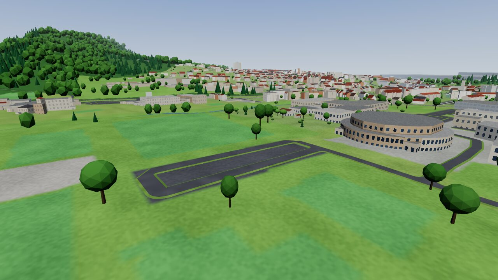 | 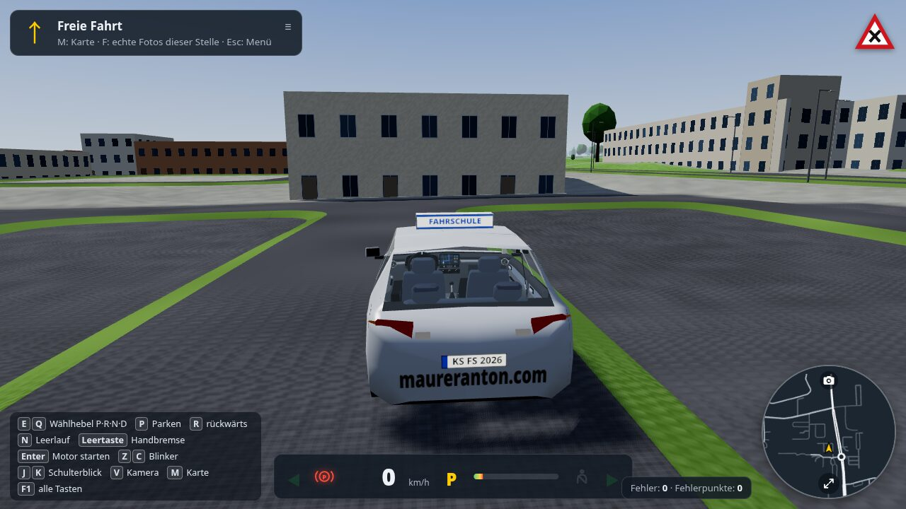 |
| 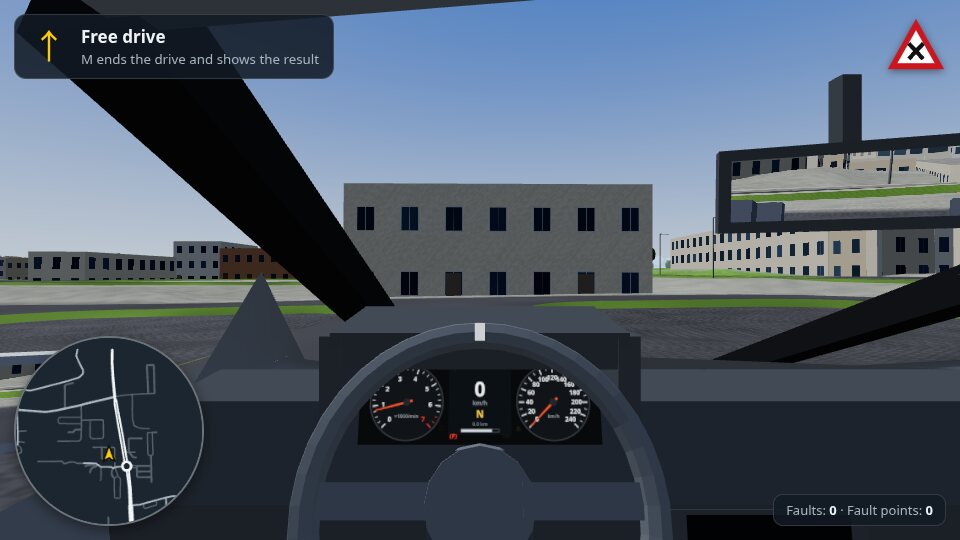 | 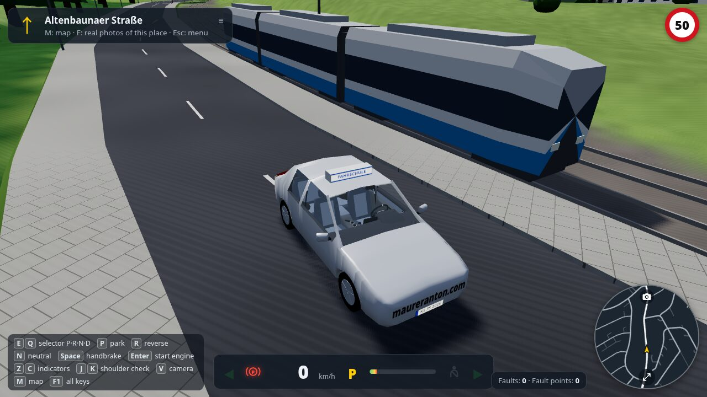 |

> Der Simulator ersetzt keine Fahrstunde und keine amtliche Prüfung. Er hilft, Regeln und Abläufe zu
> verstehen und zu üben – Verkehrsbeobachtung und Verantwortung lernt man nur im echten Verkehr mit
> einer Fahrlehrerin oder einem Fahrlehrer.

## Was drin ist

- **Nordhessen in echt:** die Stadt Kassel und die Landkreise Kassel, Schwalm-Eder, Werra-Meißner,
  Waldeck-Frankenberg und Hersfeld-Rotenburg – rund 6 900 km² von Bad Karlshafen bis Bad Hersfeld und von
  Willingen bis Eschwege, 115 Städte und Gemeinden – mit allen Straßen und Wegen (41 500 km, davon
  16 300 km Straßen und 25 200 km Feld- und Waldwege), den Autobahnen A 4, A 5, A 7, A 44 und A 49,
  Kreisverkehren, dem VW-Werk: aus OpenStreetMap. Gelände aus dem amtlichen 1-m-Höhenmodell, gut eine
  Million Gebäude mit ihren echten Höhen und Dachformen aus dem amtlichen 3D-Gebäudemodell (LoD2) des
  Landes Hessen. Geladen wird immer nur die Umgebung des Fahrzeugs; die ganze Karte hat knapp 900 MB – so
  viel, wie auf GitHub Pages Platz hat.
- **Verkehrsregelung am richtigen Ort:** Ampeln, Zebrastreifen, Stopp- und Vorfahrt-gewähren-Schilder,
  Tempolimits, Tempo-30-Zonen, verkehrsberuhigte Bereiche, Einbahnstraßen, Abbiegeverbote und Ortstafeln aus
  den OSM-Daten. Wo OSM nichts sagt, gilt die deutsche Regel – und so stehen dort auch die Schilder
  (siehe [Kartendaten](docs/MAP_DATA.md)).
- **Fahrphysik:** Sechs-Freiheitsgrade-Fahrzeug mit Federung, Reifenmodell (Haft- und Gleitreibung,
  Lastverlagerung), Motor mit Drehmomentkurve, **Kupplung mit Schleifpunkt, Abwürgen und Anlasser**,
  6-Gang-H-Schaltung, ABS, Handbremse, Berganfahren. Automatik (Voreinstellung), Kupplungshilfe oder
  Schaltgetriebe; **Motorleistung wählbar** – für jedes Fahrzeug eigene Stufen im Rahmen seiner Klasse (Pkw
  60 bis 200 PS, voreingestellt 75 PS; Moped höchstens 4 kW, 125er höchstens 11 kW, A2 höchstens 35 kW; Lkw,
  Busse und Traktoren in ihren üblichen Größen). Ein Tempobegrenzer nimmt
  bei Tastatur und Touch das Gas am Tempolimit zurück, und die Tastaturlenkung richtet sich nach der
  Querbeschleunigung – auch bei Autobahntempo bleibt das Auto ruhig.
- **Ein Fahrzeug für jede Klasse:** Pkw (B), Pkw mit Tandem-Kastenanhänger (BE), Mofa/Moped (AM),
  125er (A1), Motorrad bis 35 kW (A2), Motorrad (A), Lkw 7,5 t (C1) und mit Anhänger (C1E), Lkw (C), Lkw
  mit Anhänger (CE), Kleinbus (D1) und mit Anhänger (D1E), Linienbus (D) und mit Gepäckanhänger (DE),
  Traktor bis 40 km/h (L) und bis 60 km/h (T) – jedes mit eigener Fahrphysik, eigenem Modell mit Cockpit
  und Spiegeln und den Regeln seiner Klasse: Der Regelwächter kennt die Höchstgeschwindigkeiten außerorts
  und auf der Autobahn (mit Anhänger 80 bzw. 60/80, Lkw über 7,5 t 60/80, Busse 80/100 km/h; § 3 Abs. 3,
  § 18 Abs. 5 StVO), Schrittgeschwindigkeit beim Rechtsabbiegen innerorts über 3,5 t (§ 9 Abs. 6 StVO) und
  das Autobahnverbot für Fahrzeuge, die bauartbedingt nicht schneller als 60 km/h fahren – Moped und
  Traktoren (§ 18 Abs. 1 StVO). Lkw und Busse sind abgeregelt. Die Wege der Navigation führen langsame
  Fahrzeuge um die Autobahn herum. Die Motorräder haben je Klasse ein eigenes Modell – vom Moped bis zur
  großen Maschine – mit einem Fahrer, der den Lenker hält.
- **Straßenbahn:** auf den Gleisen von Kassel und Baunatal (106 km, rund 135 Haltestellen), von der
  Haltestelle aus, die man im Menü wählt (nach Gemeinden geordnet). Ein Fahrschalter für Fahren und Bremsen
  (die Pedale), die Notbremse mit Schienenbremse (die Handbremse), die Klingel (die Hupe); an der Weiche
  wählt der Blinker den Weg – sonst folgt die Bahn ihrer Linie. An der Haltestelle: an der Haltemarke halten,
  Türen öffnen (`G`), Fahrgäste steigen aus und ein, Türen schließen – dann weiter. Der Fahrlehrer achtet auf
  das Tempo in Kurven und auf der Straße, auf jede Haltestelle, auf die Türen und auf rote Ampeln, wo das
  Gleis eine Kreuzung quert. Eine Fahrstunde mit fünf Haltestellen, die freie Fahrt und eine Vorführfahrt, auf
  der die Bahn selbst fährt. Die Bahnen des Verkehrs fahren ihre echten **Linien** (1–8, RT1, RT4 und RT5,
  aus OpenStreetMap) mit Nummer und Ziel an der Front; die große Karte zeigt Gleise und Haltestellen.
  **Echte Fahrpläne:** Die Bahnen des Verkehrs sind dort unterwegs, wo der Fahrplan (gtfs.de, Daten von DELFI e.V.)
  sie gerade hat, und fahren an keiner Haltestelle zu früh ab; die Abfahrtsanzeiger zeigen die echten nächsten
  Abfahrten, und an der Haltestelle sagt die Anzeige, ob die eigene Bahn pünktlich ist.
  **Strom aus der Oberleitung:** Die Fahrt beginnt mit gesenktem **Stromabnehmer** – `P` (oder ein Tipp auf den
  Hinweis) hebt ihn an den Fahrdraht, erst dann zieht die Bahn; gesenkt wird er nicht, solange die Motoren Strom
  ziehen, und vor dem Ende des Fahrdrahts, wo die RegioTram mit ihrem Motor weiterfährt. Im Menü: eine Einheit,
  **zwei gekuppelte Einheiten** (Doppeltraktion) oder eine Bahn mit **Beiwagen**, der nur Gewicht ist.
- **Haltestellen zum Sehen:** 3 644 Haltestellen von Bus und Bahn mit ihren echten Namen – Bahnsteige,
  Wartehallen, das Haltestellenschild (Zeichen 224) mit dem Namen, Bänke, Abfahrtsanzeiger und Leute, die
  warten und ein- und aussteigen, wenn eine Bahn oder ein Bus hält; an der Haltemarke die Haltetafel (Sh 7).
  Über den Gleisen die Oberleitung mit ihren Masten, wo das Gleis eine Kreuzung mit Ampel quert die
  Straßenbahnsignale (F 0 bis F 5 nach BOStrab), vor den Weichen die Weichensignale (W 1 bis W 3), die zeigen,
  wohin die Weiche für die nächste Bahn gestellt ist.
- **Bus auf der Linie:** Stadtbusse im Verkehr fahren ihre **echten Linien** aus OpenStreetMap (625 Linienwege in
  Nordhessen) mit Nummer und Ziel an Front, Seite und Heck, halten an ihren Haltestellen mit der vorderen Tür
  am Mast und fahren mit Blinker wieder an; am Ende der Linie geht es auf der Gegenrichtung zurück. Dazu eine Fahrstunde für die Busklassen: fünf Haltestellen bedienen – am Mast
  halten, Türen öffnen (`G`), Fahrgäste aus- und einsteigen lassen, Türen schließen, links blinken und
  anfahren (§ 10 StVO).
- **Zu Fuß unterwegs:** „Zu Fuß“ im Fahrzeugmenü – durch die Stadt gehen und rennen (wie schnell, sagen die
  Einstellungen), an der Fußgängerampel den **Taster drücken** („Signal kommt“), am **Zebrastreifen** halten
  die Autos (§ 26 StVO), beim Abbiegen lassen sie einen gehen (§ 9 Abs. 3 StVO) – und an der Haltestelle in
  **Straßenbahn oder Bus einsteigen**, mitfahren und an einer späteren Haltestelle wieder aussteigen. Der
  Fahrlehrer achtet auch zu Fuß auf die Regeln: Gehweg statt Fahrbahn (§ 25 Abs. 1), über die Straße am
  Überweg, wenn einer nah ist (§ 25 Abs. 3), nicht bei Rot (§ 37 Abs. 2 Nr. 5 StVO). Die Kamerataste (`V`)
  zeigt einen **von hinten** – als eigene Figur, die geht und rennt.
- **Wiederholung:** Jede Fahrt wird mitgeschrieben (die letzte halbe Stunde) und lässt sich aus dem Pausenmenü
  oder dem Ergebnis **1:1 noch einmal ansehen** – das eigene Fahrzeug, der Verkehr, die Bahnen und die Ampeln,
  wie sie waren; von hinten, vom Fahrersitz oder frei um das Fahrzeug, langsamer oder schneller, mit den
  Hinweisen des Fahrlehrers als Marken auf der Zeitleiste.
- **Hauptmenü in Reihen:** Fahrzeug, Ort und Startpunkt, die Optionen des Fahrzeugs und die Art der Fahrt als
  Reihen von Karten zum Wischen über dem 3D-Bild – dahinter steht das gewählte Fahrzeug dort, wo die Fahrt
  beginnt. Das einfache Menü von früher lässt sich in den Einstellungen wählen.
- **Jedes Modell:** ein Testplatz auf dem Übungsplatz mit allen Fahrzeugen des Spiels nebeneinander (jede
  Führerscheinklasse, mit und ohne Anhänger), den Autos, Radfahrern und Leuten des Verkehrs, zwei Straßenbahnen
  und dem Flugzeug – zu Fuß oder mit dem eigenen Fahrzeug zwischen ihnen.
- **Fliegen:** ein Leichtflugzeug (zweisitziger Schulterdecker, 100 bis 180 PS) startet von den
  21 Flugplätzen Nordhessens – vom Flughafen Kassel-Calden oder von einem der kleinen Plätze; Start- und
  Landebahnen, Rollwege und Vorfelder sind mit ihren Markierungen gezeichnet. Eigene Flugphysik (Auftrieb und
  Strömungsabriss, Propeller, Fahrwerk, Landeklappen), ein Cockpit mit allen Instrumenten; der Steuerknüppel
  liegt auf den Pfeiltasten, dem Gamepad oder – auf dem Touchscreen – der Lenkleiste.
- **Fernsicht:** jenseits der geladenen Kacheln das Gelände der ganzen Region (ein Punkt alle 100 m, mit
  Wald, Feld und Ort) – die Hügel am Horizont und das Land unter dem Flugzeug; in den Grafikeinstellungen
  5 bis 30 km weit oder aus.
- **Lkw mit Anhänger (Klasse CE):** ein 12-Tonner mit Tandemanhänger (15,7 m, 15,5 t) und alles, was die
  praktische Prüfung verlangt – siehe [unten](#lkw-mit-anhänger-klasse-ce).
- **Zu Fuß ums Fahrzeug:** Aussteigen (`G`, aus dem Pausenmenü oder per Fingertipp, wenn das Fahrzeug mit
  abgestelltem Motor und angezogener Handbremse steht), um das Fahrzeug herumgehen und vor der Fahrt
  kontrollieren – Reifen, Licht vorn und hinten, beim Zug die Kupplung; Ringe am Boden zeigen, wo –, dann an
  der Fahrertür einsteigen. Auf Wunsch beginnt jede Fahrt neben dem Fahrzeug (Einstellungen). Der Fahrlehrer
  achtet darauf, dass vor dem Öffnen der Tür nach hinten gesehen (§ 14 Abs. 1 StVO) und das Fahrzeug
  gesichert wird – Motor aus, Handbremse an (§ 14 Abs. 2 StVO).
- **Drei Ansichten:** von außen hinter dem Fahrzeug (Voreinstellung; die Kamera lässt sich mit Maus oder
  Finger rund um das Fahrzeug drehen und im Abstand verstellen, `U` blickt nach hinten), aus dem **Cockpit**
  mit Lenkrad, Schalthebel, Pedalen, Kombiinstrument und **drei funktionierenden Spiegeln**, die optisch
  korrekt aus der Augposition berechnet werden – und eine **freie Kamera**, die man mit Finger, Maus oder
  Tasten hinstellt, wohin man will, und die dort bleibt, während man weiterfährt. Der Innenraum lässt sich in
  den Einstellungen durchscheinend machen.
- **Fahrlehrer im Beifahrersitz:** Der Regelwächter erkennt u. a. zu schnelles Fahren, Rotlicht,
  überfahrene Stoppschilder, missachtete Vorfahrt (Schilder, **rechts vor links**, Kreisverkehr, § 10),
  Fehler beim Abbiegen und Blinken, Zebrastreifen, Radfahrer beim Abbiegen, falsche Fahrtrichtung, Fahren
  auf dem Gehweg, zu geringen Abstand – rund 50 Fehlerarten, jeweils mit Erklärung und Fundstelle in der
  StVO. Seine Hinweise erscheinen im Feld des Straßennamens. Jeder Fehler zählt Punkte (leichter Fehler 1,
  schwerer 3, „nicht bestanden“ 10); in der Prüfungsfahrt zählen auch Hinweise, und ab 10 Punkten ist sie
  nicht bestanden. Am Ende jeder Fahrstunde – und auf Wunsch der freien Fahrt – steht eine Auswertung.
- **Regel-Hilfe** (abschaltbar): das Tempolimit, die Zone und die Vorfahrt an der nächsten Kreuzung als
  Schild – oder die Ampel, auch mit grünem Pfeil, auch ausgefallen. Dazu Lampen für Handbremse und Gurt
  (wer gegen die Handbremse anfährt, hört einen Warnton).
- **Fehlerprotokoll:** Jeder Fehler dieser und früherer Fahrten mit Datum, Straße und Erklärung; die
  Fundstelle führt mit einem Klick zum amtlichen Wortlaut des Paragrafen (gesetze-im-internet.de).
- **Fahrstunden und Prüfungsfahrt:** Grundlagen (Anfahren, Schalten, Anhalten; mit dem Pkw), rechts vor
  links, Vorfahrtschilder, Ampeln, Kreisverkehr, Überland, Autobahn (nicht mit dem Traktor) – und eine
  Prüfungsfahrt mit Auswertung, mit jedem Fahrzeug (Klasse CE: eine eigene, siehe unten).
- **Ampeln:** feste Programme mit der deutschen Phasenfolge; wo das Rechtsabbiegen niemanden kreuzt (etwa
  von der Hauptstraße in eine einmündende Seitenstraße), hängt ein **grüner Pfeil** neben dem Licht – bei
  Rot darf, wer rechts abbiegt, fahren. Jeden Tag sind rund 6 % der Ampeln **ausgefallen** und blinken
  gelb: dann gelten die Schilder darunter oder rechts vor links.
- **Fahrt planen – Vorführfahrt oder Zielführung:** Ziele auf der Karte antippen oder als Adresse eingeben.
  Dann fährt das Auto selbst und regelgerecht dorthin – so sieht man, wie der Weg zu fahren ist: wo
  geblinkt und über die Schulter gesehen wird, wo rechts vor links gilt, wie schnell und mit welchem
  Abstand; eine Zeile erklärt mit, was der Fahrer gerade tut, und wer lenkt oder bremst, übernimmt selbst.
  Oder man fährt selbst und lässt sich den Weg ansagen – auf dem Bildschirm und gesprochen (Einstellung
  „Ansagen“), mit dem Fahrstreifen, in den man sich vor der Kreuzung einordnet. Mehr dazu [unten](#fahrt-planen).
- **Rundfahrt durch die Straßen:** Länge in Kilometern wählen – der Simulator plant eine Strecke dieser
  Länge, die durch möglichst viele verschiedene Straßen führt und möglichst keine zweimal: vom Standort
  zurück zum Standort oder zu einem Ziel. Zum Selbstfahren oder als Vorführfahrt. Dazu Wünsche: keine
  Autobahnen, keine Schnellstraßen, Hauptstraßen nur zum Weiterkommen – und vor allem durch Straßen mit
  kleinen Häusern, durch Wohnblocks und Ortskerne oder über Land. Beim Planen zeigt ein Balken, wie weit es
  ist; gefahrene Rundfahrten werden mit Datum gespeichert und lassen sich auf der Karte wieder ansehen.
- **Verkehr:** Fahrzeuge, die Ampeln, Vorfahrt und Abstand beachten, Fußgänger an Überwegen – und
  **Straßenbahnen und Züge**, die auf den echten Gleisen fahren, sobald welche in der Nähe sind, und an den
  Haltestellen halten.
- **Radfahrer:** fahren innerorts auf dem Radweg neben der Fahrbahn geradeaus über die Kreuzungen. Wer
  rechts abbiegt, muss sie durchlassen (§ 9 Abs. 3 StVO) – und ab und zu kommt genau dann einer: einer, den
  man kurz vorher überholt hat, oder einer, der von hinten heranrollt, während man an der Linie wartet. Wer
  den Schulterblick macht, sieht ihn; wer ihm den Weg abschneidet, bekommt einen schweren Fehler.
- **Große Karte** (`M` oder die Pfeile an der kleinen Karte): eigener Standort, die schon gefahrene Strecke,
  Ortsnamen – und in der freien Fahrt lässt sich das Fahrzeug per Fingertipp an jede Stelle setzen. Auf
  Wunsch mit den **amtlichen Luftbildern** des Landes Hessen als Hintergrund.
- **Realansicht:** „Wie sieht es hier in echt aus?“ – Taste `F` zeigt echte Straßenfotos der Stelle, an der
  das Auto steht: aus den freien Bilddiensten Panoramax, KartaView und Mapillary oder aus eigenen Bildern
  (auch 360°-Panoramen, wie sie Street-View-Downloader speichern), dazu die Koordinaten und Links, die
  dieselbe Stelle bei KartaView, Mapillary, Panoramax, Google Street View, Google Maps, Google Earth und
  OpenStreetMap öffnen. Mehr dazu [unten](#realansicht).
- **Start an jeder Adresse:** Straße und Hausnummer eintippen (rund 310 000 Hausnummern in 27 500 Straßen
  aus OpenStreetMap) – das Fahrzeug steht am Straßenrand vor dem Haus. In der freien Fahrt auch als Sprung
  aus dem Pausenmenü. Oder einer von gut 400 Startpunkten in 115 Orten.
- Tastatur, Gamepad, **Lenkrad mit Pedalen und H-Schaltung** (Gamepad-API) und **Touchscreen** – auf dem
  Smartphone ist alles ohne Tastatur erreichbar. **Einstellungen**, Startpunkt, Fehlerprotokoll und
  gefahrene Strecke bleiben im Browser gespeichert. **Einstellungen:** Grafik – Voreinstellungen (niedrig
  bis sehr hoch), die die Auflösung nicht ändern; davon getrennt Größe der Oberfläche, Bildschirm- und
  3D-Auflösung; in den erweiterten Einstellungen einzeln Schatten, Sichtweite, Bäume und Objekte am Rand,
  Gebäude mit oder ohne Fenster, Schatten von Bäumen und Schildern –, die Karte auf dem Bildschirm des
  Autos (Fahrersicht), die Fernsicht, Spiegel, Verkehrsdichte, Lautstärke, Getriebe, Laufgeschwindigkeit zu
  Fuß, Tempobegrenzer,
  Kamera beim Start, durchscheinender Innenraum, Bildschirmsteuerung und ihre Deckkraft, Tastenhilfe,
  Regel-Hilfe, Ganganzeige, gesprochene Ansagen, Start neben dem Fahrzeug – und die **Bildrate** (Bilder
  pro Sekunde, oben rechts).
- **Was ist neu:** Die Neuerungen jeder Version stehen im Spiel, in allen Sprachen – nach einem Update
  einmal von selbst, sonst über „Was ist neu“ im Menü; darunter steht die Version.
- **28 Sprachen**, vollständig übersetzt – darunter alle Sprachen, in denen man in Deutschland die
  Theorieprüfung ablegen kann. Siehe [Sprachen](#sprachen).

| | |
| --- | --- |
| 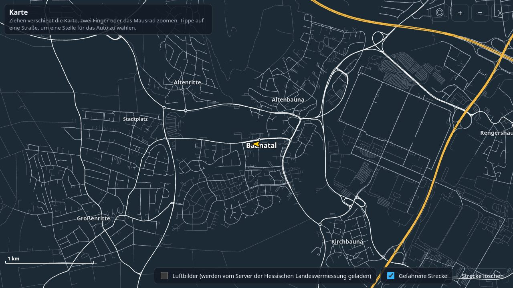 | 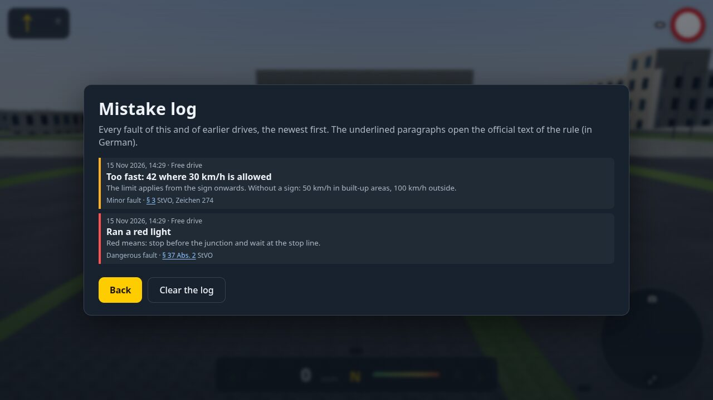 |

## Steuerung (Tastatur)

| Taste | Funktion |
| --- | --- |
| `W` `S` / `↑` `↓` | Gas / Bremse |
| `A` `D` / `←` `→` | Lenken |
| `Umschalt` | Kupplung (im Modus „Kupplung selbst“) |
| `E` `Q` | Gang hoch / runter (Automatik: Wählhebel) |
| `1`–`6`, `R`, `N` | Gang direkt, Rückwärtsgang, Leerlauf |
| `Leertaste` | Handbremse |
| `Enter` (halten) / `I` | Motor starten / Zündung aus |
| `Y` `C` / `X` | Blinker links / rechts, Warnblinker (unterste Tastenreihe) |
| `J` `K` | Schulterblick links / rechts |
| `U` (halten) | nach hinten sehen |
| Maus ziehen (oder `Alt` halten und Maus bewegen) · Mausrad | umsehen bzw. Kamera um das Fahrzeug drehen · Abstand der Kamera |
| `B` · `L` `O` · `H` | Gurt · Abblend-/Fernlicht · Hupe |
| `P` · `0` | Automatik: Parkstellung · Leerlauf |
| `G` | aussteigen (im Stand) / an der Fahrertür einsteigen – zu Fuß: `W` `S` gehen, `A` `D` drehen, Maus umsehen, `Umschalt` rennen; an der Fußgängerampel den Taster drücken, in Bahn oder Bus ein- und aussteigen |
| Flugzeug: `↑` `↓` `←` `→` · `W` `S` · `A` `D` · `Leertaste` · `G` | Steuerknüppel · Gas · Seitenruder · Bremsen · Landeklappen |
| `F1` | Übersicht der Tasten |
| `V` · `T` · `Esc` | Kamera (außen / Cockpit / frei) · Fahrzeug zurück auf die Straße · Pause |
| freie Kamera: `Alt` + `W` `A` `S` `D` · `Alt` + `E` `Q` · rechte Maustaste ziehen | fliegen · höher / tiefer · verschieben (das Auto rollt solange von selbst weiter) |
| `M` | große Karte |
| `F` | Realansicht: echte Fotos dieser Stelle |

Beim Fahren mit der Tastatur blendet der Simulator im Stand eine kurze Tastenhilfe ein (Gänge, Handbremse,
Blinker …); sie verschwindet, sobald das Auto rollt, und lässt sich in den Einstellungen abschalten.

### Maus und Touchscreen

| Antippen / Anklicken | Funktion |
| --- | --- |
| Straßenname oben links | Pausenmenü mit Einstellungen, Steuerung, Sprung zu einer Adresse |
| Karte | Realansicht: echte Fotos dieser Stelle |
| Pfeile an der Karte | große Karte: Standort, gefahrene Strecke, Fahrzeug versetzen, Luftbilder |
| Über das Bild wischen | im Cockpit: umsehen (Schulterblick), loslassen = wieder geradeaus; von außen: die Kamera drehen (sie bleibt) |
| Zwei Finger | Abstand der Kamera (spreizen / zusammenziehen); freie Kamera: verschieben |
| Gelber Hinweis unten | führt den Hinweis aus (anschnallen, Motor starten, Handbremse lösen …) |

Auf dem Touchscreen liegen links die Lenkleiste und die Blinker, rechts Gas, Bremse, Gänge (▲ ▼) und
Handbremse (P); „⋯“ oben öffnet Gurt, Anlasser, Licht, Warnblinker, Hupe, Kamera und mehr. Die Mitte des
Bildes bleibt frei. Die Bedienelemente erscheinen automatisch, sobald der Bildschirm berührt wird, und
verschwinden, sobald eine Tastatur benutzt wird (praktisch bei Tablets mit Tastatur); in den Einstellungen
lassen sie sich dauerhaft ein- oder ausschalten und in der **Deckkraft** verstellen.

**Zurück auf die Straße** (`T`, auf dem Touchscreen unter „⋯“) stellt das Fahrzeug in die Mitte seines
Fahrstreifens, an eine Stelle, an der es nirgends anstößt – und ein Stück weiter vorn, wenn man es dort
gleich noch einmal verlangt.

**Hinweise des Fahrlehrers** (Fehler rot, kleinere Fehler und Hinweise gelb) erscheinen in dem Feld, in dem
sonst der Straßenname steht. Treffen mehrere zusammen, wird der schwerwiegendste angezeigt; eine
angekündigte Abbiegung bleibt darunter lesbar.

| | |
| --- | --- |
|  |  |

## Fahrt planen

Wer wissen will, wie eine bestimmte Strecke zu fahren ist – der Weg zur Arbeit, zur Fahrschule, die
Prüfungsstrecke –, lässt sie sich vorfahren oder fährt sie selbst mit Zielführung:

1. Im Hauptmenü „Vorführfahrt“ oder „Rundfahrt durch die Straßen“ wählen (Startpunkt oder Startadresse
   wie gewohnt) – oder in der freien Fahrt die große Karte öffnen (`M`) und dort „Fahrt planen“.
2. Ziele hinzufügen: eine Straße auf der Karte antippen und „Als Ziel hinzufügen“ – oder eine Adresse
   eingeben. Mehrere Ziele werden in ihrer Reihenfolge angefahren. Die Ziele dürfen irgendwo auf der Karte
   liegen, auch 80 km entfernt.
3. **„Auto fahren lassen“:** Das Auto fährt selbst los. Oben steht die Ansage des Navis, darunter, was der
   Fahrer gerade tut und warum („Vor dem Abbiegen: Spiegel, Blinker, Schulterblick – und langsamer werden“).
   Im Cockpit dreht sich dabei der Kopf zum Schulterblick. Am letzten Ziel hält das Auto an.
   **„Selbst fahren“:** dieselbe Strecke mit Ansagen und der Route auf der kleinen Karte; wer falsch
   abbiegt, bekommt einen neuen Weg.

| | |
| --- | --- |
| 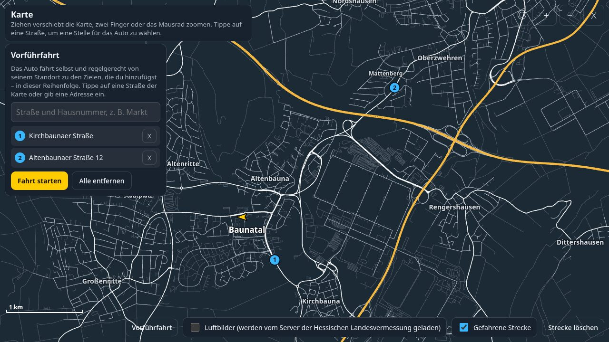 |  |

Lenken, Gas oder Bremse übergeben das Auto jederzeit an den Fahrschüler. Gefahren wird mit Automatik; es
fährt derselbe „virtuelle Fahrschüler“, der in den automatischen Tests alle Fahrstunden ohne Fehlermeldung
des Regelwächters abfährt (siehe [Tests](#tests)) – mit dem Lkw samt Anhänger ebenso.

Zwei Dinge kann dieser Fahrer nicht, und der Simulator sagt es dann: **Wenden in der Sackgasse** (er hält
am Ende der Straße an, das Auto wird dort umgedreht) und um ein Hindernis herumfahren, das nicht da sein
dürfte. Steht er länger als ein paar Sekunden, ohne auf eine Ampel oder den Verkehr zu warten, wird das
Auto ein Stück weiter vorn wieder in seinen Fahrstreifen gesetzt.

### Rundfahrt durch die Straßen

Im Feld „Fahrt planen“ der großen Karte die **Länge** eingeben (1 bis 300 km) und „Rundfahrt planen“:
Der Simulator sucht eine Strecke etwa dieser Länge, die durch möglichst viele verschiedene Straßen führt
und möglichst keine zweimal. Ohne Ziel führt sie zum Standort zurück, mit Zielen endet sie am letzten der
Liste. Die Karte zeigt die Strecke (orange) und was sie bringt: Gesamtlänge, davon neue Straßen, davon
doppelt gefahrene. Dann wie oben: selbst fahren oder fahren lassen. Wer von der Rundfahrt abkommt, wird
wieder auf sie zurückgeführt.

Die beste solche Strecke zu finden ist ein schweres Problem (ein Verwandter des Briefträgerproblems);
gesucht wird deshalb so: von Kreuzung zu Kreuzung immer in eine noch nicht gefahrene Straße – in die, von
der aus es am besten durch neue Straßen weitergeht –, und wenn es keine gibt, zur nächsten neuen Straße,
die die restliche Länge noch erlaubt; dabei bleibt stets genug Länge für den Weg zum Ende. Das wird einige
hundert Male mit wechselnden Vorlieben wiederholt, die beste Strecke gewinnt. In Wohngebieten kommen so
meist 80 bis 85 % neue Straße zusammen. Gewendet wird nicht, Sackgassen, Privatwege, Höfe, Parkplätze und
Schritttempo-Straßen bleiben außen vor (außer am Anfang und am Ende); Autobahnen werden benutzt, zählen
aber nicht als „gesehen“.

## Lkw mit Anhänger (Klasse CE)

Im Hauptmenü lässt sich statt des Pkw ein **Lkw mit Anhänger** wählen: ein zweiachsiger 12-Tonner mit
Tandem-Zentralachsanhänger – zusammen 15,7 m lang und 15,5 t schwer, wie ihn die Fahrerlaubnis-Verordnung
für die Prüfung der Klasse CE verlangt. Der Lkw hat eine eigene Fahrphysik (Heckantrieb, automatisiertes
8-Gang-Getriebe, lange Bremswege, bei 89 km/h abgeregelt); der Anhänger
läuft der Kupplung nach, schiebt und bremst mit seiner Masse und knickt beim Rückwärtsfahren ein, wenn man
nicht rechtzeitig gegenlenkt.

Geübt wird, was die praktische Prüfung nach Anlage 7 der Fahrerlaubnis-Verordnung verlangt:

| Fahrstunde | Inhalt |
| --- | --- |
| **CE 1 · Verbinden und Trennen** | Abkuppeln und wieder ankuppeln in der richtigen Reihenfolge: Anhänger sichern (Feststellbremse, Unterlegkeile, Stützfuß), Leitungen lösen – Rot zuerst –, Kupplung öffnen, vorziehen; dann in zwei Zügen ankuppeln, Kupplung prüfen, Leitungen anschließen – Gelb zuerst –, Beleuchtung prüfen, Bremsprobe. Was zu Fuß zu tun ist, wählt man aus einer Liste; eine falsche Reihenfolge ist ein Fehler mit Erklärung. |
| **CE 2 · Rückwärts um die Ecke nach links** | Grundfahraufgabe: den Zug rückwärts in eine Seitenstraße fahren, höchstens zwei Korrekturzüge, keine Begrenzung überfahren. |
| **CE 3 · Rückwärts versetzt nach rechts an die Rampe** | Grundfahraufgabe: rückwärts in die Ladebucht, höchstens einen Meter vor der Rampe halten, ohne sie zu berühren. |
| **Prüfungsfahrt Klasse CE** | alle drei Aufgaben nacheinander, dann eine Fahrt im Verkehr. Eine misslungene Grundfahraufgabe darf einmal wiederholt werden. |

| | |
| --- | --- |
| 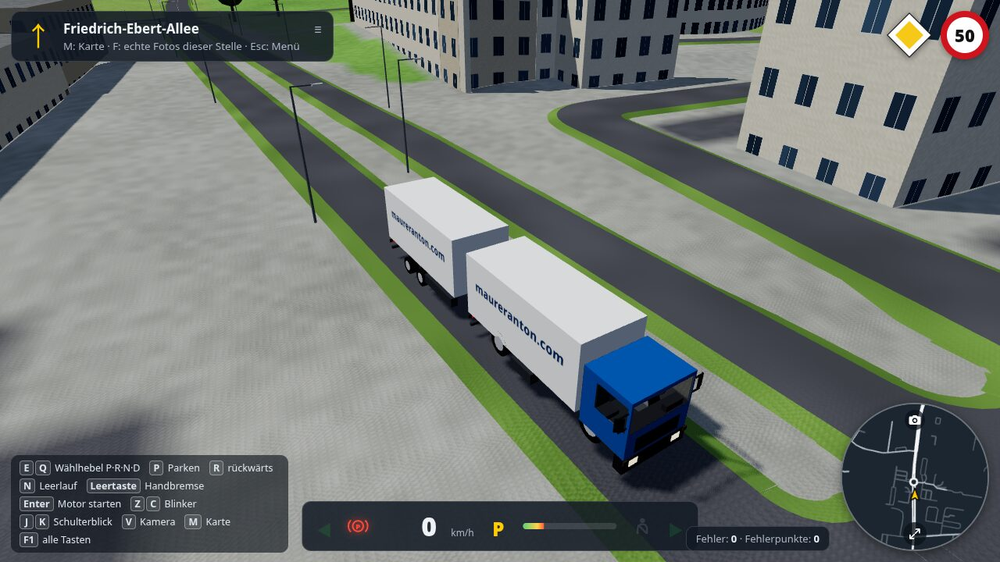 | 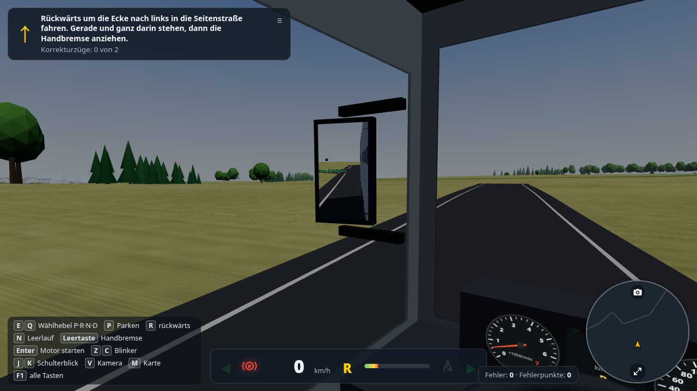 |
|  | 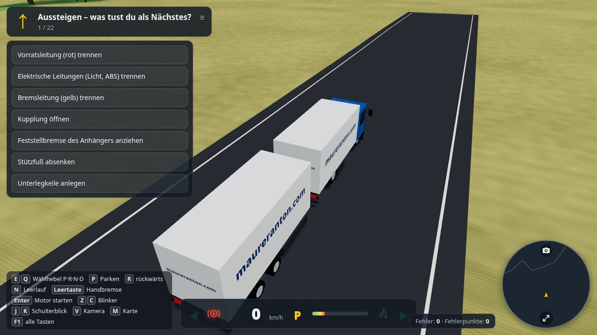 |

Die Bewertung der Grundfahraufgaben (Begrenzungen gelten für die Räder, zwei Korrekturzüge, eine
Wiederholung) lehnt sich an die Prüfungsrichtlinie an. Dazu kommen die Fahrstunden im Straßenverkehr und
die freie Fahrt mit dem Lkw. Der Regelwächter kennt die
Regeln für Lkw: 60 km/h außerorts und 80 km/h auf der Autobahn (§ 3 Abs. 3, § 18 Abs. 5 StVO),
Schrittgeschwindigkeit beim Rechtsabbiegen innerorts (§ 9 Abs. 6 StVO). Die Grundfahraufgaben finden auf
einem Übungsplatz statt, den das Spiel auf einem freien Feld bei Baunatal auslegt. Vor der Fahrt kann man
um den Zug herumgehen und ihn kontrollieren – Reifen, Licht, Kupplung (siehe „Zu Fuß ums Fahrzeug“); als
eigene Aufgabe auf dem Übungsplatz ist die Abfahrtkontrolle nicht nachgebildet.

## Sprachen

Deutsch · English · Bahasa Indonesia · Čeština · Español · Français · Hrvatski · Italiano · Magyar ·
Nederlands · Polski · Português · Română · Shqip · Tiếng Việt · Türkçe · Ελληνικά · Български · Русский ·
Українська · العربية · فارسی · اردو · हिन्दी · বাংলা · 简体中文 · 日本語 · 한국어

Die Sprache richtet sich beim ersten Start nach dem Browser (wer Serbisch, Bosnisch, Slowakisch oder
Malaiisch eingestellt hat, bekommt die nächstverwandte Sprache) und lässt sich oben im Hauptmenü und in den
Einstellungen umstellen; `?lang=fr` in der Adresse wählt sie für einen Besuch. Übersetzt ist alles: Menüs,
Fahrstunden, die Hinweise des Fahrlehrers mit ihren Erklärungen, die Steuerungsübersicht und die
Realansicht; Strecken, Zeiten und Datumsangaben schreibt der Browser in der Form der jeweiligen Sprache.
Die Fundstellen bleiben in jeder Sprache die deutschen (z. B. „§ 37 Abs. 2 StVO“), ebenso die Nummern der
Verkehrszeichen und natürlich die Straßennamen. Arabisch, Persisch und Urdu werden von rechts nach links
gesetzt; die Bedienelemente behalten dabei ihren Platz. Tasten werden so benannt, wie sie auf der eigenen
Tastatur stehen – gesteuert wird nach der Lage der Taste, auf einer französischen Tastatur also mit Z Q S D
statt W A S D.

| | |
| --- | --- |
|  |  |

Die Übersetzungen wurden maschinell (mit einem KI-Sprachmodell) nach einem Glossar der Fachbegriffe erstellt
und automatisch auf Vollständigkeit, Platzhalter und Länge geprüft, aber **nicht von Muttersprachlern
gegengelesen**. Verbesserungen sind willkommen: eine Sprache ist eine Datei in `src/i18n/`, die Regeln
stehen in [docs/TRANSLATING.md](docs/TRANSLATING.md), `npm run i18n:check` prüft sie.

## Realansicht

Mit `F` (oder im Pausenmenü) öffnet sich die Realansicht für die Stelle, an der das Auto gerade steht – zum
Vergleichen: Welche Schilder stehen dort wirklich, wie sieht die Kreuzung aus?

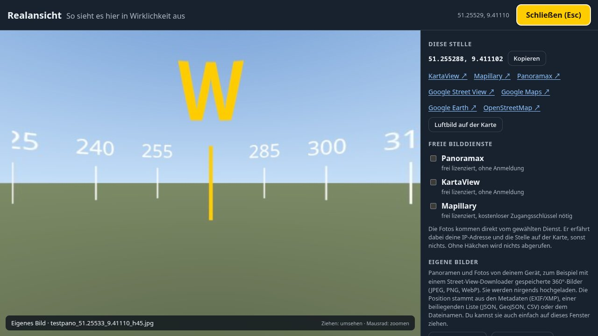

- **Freie Bilddienste:** [Panoramax](https://panoramax.fr) und [KartaView](https://kartaview.org) ohne
  Anmeldung, [Mapillary](https://www.mapillary.com) (Meta) mit einem kostenlosen Zugangsschlüssel, den man
  im Fenster einträgt. Die Fotos stehen unter CC BY-SA 4.0 und werden mit Urheber, Datum und Link zum
  Original angezeigt. Panoramax und KartaView haben Bilder aus Baunatal, wenn auch lückenhaft; Mapillary
  ist in deutschen Städten meist am dichtesten abgedeckt.
- **Eigene Bilder:** Fotos und 360°-Panoramen vom eigenen Gerät (JPEG, PNG, WebP) per Dateiauswahl, Ordner
  oder Ziehen ins Fenster – etwa mit *streetview-dl*, *streetviewdownloader* oder einer Browser-Erweiterung
  gespeicherte Panoramen. Position und Blickrichtung werden aus EXIF/XMP, einer beiliegenden Liste (JSON,
  GeoJSON, CSV) oder dem Dateinamen gelesen; Panoramen lassen sich mit der Maus drehen und zeigen zuerst in
  Fahrtrichtung. Die Bilder bleiben auf dem eigenen Gerät. Einzelheiten:
  [public/panos/README.md](public/panos/README.md).
- **Dieser Ort:** Oben im Fenster stehen die Koordinaten (zum Kopieren) und Links, die dieselbe Stelle in
  einem neuen Tab öffnen: KartaView, Mapillary, Panoramax, Google Street View, Google Maps (Satellit),
  Google Earth und OpenStreetMap.
- **Luftbild:** „Luftbild auf der Karte“ öffnet die große Karte an dieser Stelle mit den amtlichen
  Luftbildern des Landes Hessen (DOP20, 20 cm je Bildpunkt) – offene Daten, die direkt vom Geodatendienst
  des Landes geladen werden.

**Datenschutz:** Der Simulator selbst ruft nichts ab. Erst wenn man in der Realansicht einen Dienst anhakt
oder auf der Karte die Luftbilder einschaltet, fragt der Browser diesen Dienst direkt – er erfährt dabei
die IP-Adresse und die Stelle auf der Karte.
**Lizenz:** Es werden keine fremden Bilder mit dem Projekt ausgeliefert; Bilder von Google Street View und
anderen nicht frei lizenzierten Quellen kann man für sich selbst laden, aber nicht weitergeben.

Wer eine eigene Kopie betreibt, kann einen Mapillary-Schlüssel als Repository-Variable `MAPILLARY_TOKEN`
hinterlegen (er wird beim Bauen als `VITE_MAPILLARY_TOKEN` eingesetzt) und eigene, frei lizenzierte Bilder
über `public/panos/` und `npm run panos:index` für alle Besucher bereitstellen.

## Lokal starten

Voraussetzung: [Node.js](https://nodejs.org) ≥ 24.

```bash
git clone https://github.com/MaurerAnton/driving-simulator.git
cd driving-simulator
npm install
npm run map:fetch  # die Karte (knapp 900 MB) vom Release des Projekts nach public/map – braucht curl und tar
npm run dev        # http://127.0.0.1:5173
npm run build      # statische Seite in dist/
```

Die Karte liegt nicht im Repository, sondern in Stücken an einem Release (welches, steht in `map.release`):
Jeder Neubau würde sonst ein Gigabyte zum Verlauf hinzufügen. Geodaten laden und die Karte selbst bauen
muss man zum Spielen und Entwickeln nicht.

### Tests

```bash
npm test             # 305 Tests: Fahrdynamik von Pkw (21), Lkw mit Anhänger (6) und den Fahrzeugen der anderen
                     # Klassen mit jeder Motorleistung (77), Flugphysik (25), Flugplätze (3), Straßenbahn fahren, ihr
                     # Stromabnehmer, Doppeltraktion und Beiwagen, ihre Linien und Fahrpläne im Verkehr (10), Fahrpläne
                     # aus GTFS (21), Buslinien aus OpenStreetMap (9), Wiederholung (4), Bus auf der Linie (2), zu Fuß an Ampel und Zebrastreifen (5), Fernsicht (2), Realansicht (15), Adresssuche, Hinweise, Fehlerprotokoll, Karte (16), Straßenbahnen (9),
                     # Klasse CE (16), Sprachen (10), Rundfahrten mit Wünschen (8), Radfahrer (11), Ampeln mit Pfeil und ausgefallene
                     # Ampeln (9), zu Fuß (6), „Was ist neu“ (3), freie Fahrstreifen (5), Straßennetz in Stücken,
                     # Kachelformat, Kreuzungsflächen (12)
npm run i18n:check   # Übersetzungen prüfen (Vollständigkeit, Platzhalter, Längen)
npm run test:traffic # Verkehrssimulation im Dauerlauf auf der echten Karte
npm run test:drive   # „virtueller Fahrschüler“ – der Fahrer der Vorführfahrten – fährt alle Fahrstunden regelkonform ab
npm run test:drive:truck     # … mit Lkw und Anhänger, einschließlich der Prüfungsfahrt der Klasse CE
npm run test:drive:traffic   # … im Umgebungsverkehr: Abstand, Vorfahrt, Fußgänger, Radfahrer beim Rechtsabbiegen
```

### Neue Version

Jede Veröffentlichung bekommt eine eigene Versionsnummer (nach 1.0.0: 1.0.1 …), und was sie bringt, steht im
Spiel unter „Was ist neu“ – in allen Sprachen:

1. `version` in `package.json` erhöhen und oben in [`src/game/releases.ts`](src/game/releases.ts) einen Eintrag
   mit den Schlüsseln seiner Neuerungen anlegen; die Texte `news.<version>.*` in `en.ts` schreiben und in alle
   Sprachen übersetzen (`npm run i18n:check`). `npm test` prüft, dass Version und Neuerungen zusammenpassen.
2. Committen, `git tag vX.Y.Z`, `git push origin main --tags`, `gh release create vX.Y.Z`.

## Karte neu erzeugen

Die Karte entsteht vollständig automatisch aus offenen Daten – das Gebiet ist, wofür man Gelände lädt.
Details, Befehle und Lizenzen: **[docs/MAP_DATA.md](docs/MAP_DATA.md)**.

```bash
python3 -I tools/fetch-geodata.py --district "Landkreis Kassel"   # Gelände und Gebäude eines Kreises laden und verkleinern
npm run map:all      # OSM-Auszug in Blöcke schneiden → Straßennetz → Kacheln Block für Block → Adressliste
npm run map:check    # Kontrolle: nichts steht in einem Fahrstreifen
```

**Ein Schild fehlt oder steht falsch?** Die Verkehrsregelung kommt aus OpenStreetMap. Am nachhaltigsten ist
es, den Fehler dort zu beheben (z. B. `highway=give_way` mit `direction`, `maxspeed`, `traffic_sign`) –
davon profitieren alle Karten und Navis. Nach dem nächsten Kartenlauf ist er auch hier korrigiert.

## Aufbau

```
src/geo, src/core      Projektion (ETRS89/UTM32), Geometrie
src/world              Straßennetz-Modell: Knoten, Kanten, Kreuzungsgeometrie, Fahrstreifen, Vorfahrt –
                       stückweise um das Fahrzeug geladen (loader.ts); das Netz des ganzen Gebiets für
                       Routen und die große Karte (routegraph.ts, netfile.ts)
src/sim/vehicle        Fahrdynamik von Pkw und Lkw (ohne Abhängigkeiten, deterministisch)
src/sim                Verkehr, Ampeln, Regelwächter, Kollisionen, Anhänger, Straßenbahnen und Züge mit
                       ihren Linien, die eigene Bahn (tramdrive.ts), Flugphysik (flight.ts) und Flugplätze,
                       der regeltreue Fahrer der Vorführfahrten (autodriver.ts), „nichts steht im
                       Fahrstreifen“ (clearlanes.ts)
src/render             three.js: Kacheln, Fernsicht, Gebäude, Schilder, Fahrzeuge, Flugzeug, Cockpit,
                       Spiegel, Haltestellen mit Leuten, Oberleitung und Signalen (transit.ts), Übungsplatz
src/i18n               Texte: eine Datei je Sprache, Tastenbeschriftung nach Tastaturbelegung
src/reality            Realansicht: Bild-Metadaten (EXIF/XMP), eigene Bilder, freie Bilddienste, Luftbilder
src/game, src/ui       Spielablauf, Fahrstunden, Aufgaben der Klasse CE, Navigation, Rundfahrten (tour.ts),
                       HUD, Menüs, große Karte
tools/                 Kartenpipeline: Geodaten laden und verkleinern (fetch-geodata.py), OSM-PBF-Leser,
                       Straßennetz des Gebiets (build-graph.ts), Kacheln je Block (build-tiles.ts), Kontrolle
                       (check-lanes.ts), Haltestellen und Flugplätze (build-stops.ts), Linien der Bahnen
                       (build-lines.ts), Fernsicht (build-far.ts); Verzeichnis eigener Straßenbilder (tools/panos)
tests/                 Fahrdynamik-Tests, Straßennetz in Stücken, Rundfahrten, Verkehrs-Dauerlauf,
                       virtueller Fahrschüler
```

Dieselbe Geometrie- und Vorfahrtlogik läuft in der Kartenpipeline, in der Physik, im Verkehr und im
Regelwächter – was man sieht, worauf die Reifen stehen und wonach bewertet wird, ist deshalb identisch.

## Stand und bekannte Grenzen

- **Automatisch geprüft:** 305 Tests (Fahrdynamik aller Fahrzeuge mit jeder Motorleistung, Flugphysik und Flugplätze,
  Straßenbahn mit Stromabnehmer, Doppeltraktion und Beiwagen, ihre Linien und Fahrpläne, Buslinien, die Wiederholung, Bus auf der Linie, zu Fuß an Fußgängerampel und Zebrastreifen, Fernsicht, Anhänger, Aufgaben der Klasse CE,
  Radfahrer, Ampeln, zu Fuß, Straßenbahnen, Sprachen, Rundfahrten, das Straßennetz in Stücken, das Kachelformat …), ein Dauerlauf des
  Umgebungsverkehrs, eine Kontrolle der gebauten Karte (ein wagenbreiter Kreis fährt jeden Fahrstreifen
  ab: nichts steht darin) und ein „virtueller Fahrschüler“, der alle Fahrstunden und die Prüfungsfahrt
  (zusammen rund 56 km) regelkonform abfährt, ohne dass der Regelwächter einen Fehler meldet – ebenso mit
  Lkw und Anhänger die Prüfungsfahrt der Klasse CE. Derselbe Fahrer fährt die Vorführfahrten.
- **Vorführfahrt im Verkehr:** Der Fahrer hält Abstand, gewährt Vorfahrt, lässt Fußgänger gehen, wechselt
  den Fahrstreifen nur in eine Lücke, hält Kreuzungen frei, wenn sich dahinter der Verkehr staut, und sieht
  an großen Knotenpunkten selbst nach dem Querverkehr. Im Testlauf mit Umgebungsverkehr (fünf Fahrstunden,
  21 km) blieb er ohne Unfall und ohne Beanstandung; unfehlbar ist er im dichten Verkehr nicht – vereinzelt
  muss ein anderes Fahrzeug seinetwegen bremsen, oder er wartet lange. Wo eine Straßenecke enger ist als
  der Wendekreis des Autos, kommt er der Mittellinie nahe. Ohne Umgebungsverkehr (Verkehrsdichte 0 in den
  Einstellungen) fährt er die geprüften Strecken ohne Beanstandung.
- **Ergänzte Regelung:** Was in OpenStreetMap nicht erfasst ist (etwa ein fehlendes Vorfahrtschild), wird
  nach den Grundregeln der StVO ergänzt und kann von der Wirklichkeit abweichen. Ampeln laufen mit
  plausiblen Festzeiten, nicht mit der echten Schaltung.
- **Umgebungsverkehr:** beachtet Vorfahrt, Ampeln und Abstand, ist an großen Knotenpunkten aber nicht
  fehlerfrei – vereinzelt blockieren sich Fahrzeuge oder kommen sich zu nahe. Fußgänger gibt es nur an
  Überwegen. Radfahrer fahren nur innerorts an Straßen mit Gehweg, immer geradeaus oder nach rechts und nie
  auf der Fahrbahn; sie kommen nur dort, wo Verkehr eingeschaltet ist.
- **Darstellung:** Gebäude haben echte Form und Höhe, aber keine Fototexturen; Fahrzeuge und Cockpit sind
  vollständig prozedural erzeugt.
- **Straßenbahn:** Die Straßenbahnsignale an Kreuzungen zeigen Halt (F 0), Fahrt (F 1) und „Halt erwarten“
  (F 4) nach der Ampel der Kreuzung, die Weichensignale die Stellung der Weiche (W 1 geradeaus, W 2 rechts,
  W 3 links). Die Fahrgäste der eigenen Bahn werden
  gezählt; die an der Haltestelle sind gezeichnet. Die Fehler der Straßenbahn verweisen auf die BOStrab
  (§ 50 Geschwindigkeiten, § 54 Türen und Haltestellen).
- **Fahrzeuge:** Das Motorrad fährt auf demselben Vierrad-Modell wie alles andere, nur schmal und mit tiefem
  Schwerpunkt – es kippt nicht und muss nicht balanciert werden; dass es sich in die Kurve legt, ist
  gezeichnet. Der Traktor fährt ohne Anbaugeräte und hat (noch) keine eigenen Fahrstunden. Beim Ein- und
  Aussteigen wird das Bild kurz dunkel – eine Tür, die aufgeht, ist nicht gezeichnet. Die Türen der Busse
  sind gezeichnet, gehen aber nicht auf.
- **Lkw:** Der Anhänger folgt der Kupplung als geführtes Modell – er wirkt mit seiner Masse auf den Lkw,
  stößt aber selbst nicht an Gebäude oder Schilder und kippt nicht. Das Verbinden und Trennen prüft die
  Reihenfolge der Handgriffe, nicht die Handgriffe selbst. Sattelzüge gibt es nicht.
- **Straßenbahnen und Züge:** fahren ihre Linien (wo deren Weg in OpenStreetMap Lücken hat, wählen sie selbst),
  die Straßenbahnen und RegioTrams nach dem Fahrplan einer typischen Woche (Montag bis Freitag, Samstag, Sonntag –
  die Zusatzfahrten der Nacht zum Samstag fehlen), die Züge ohne Fahrplan; sie beachten einander und Fahrzeuge auf
  dem Gleis, aber keine Signale; Schranken an Bahnübergängen gibt es nicht. Wer auf eine Bahn wartet, sieht sie erst,
  wenn sie in den Umkreis von gut einem halben Kilometer kommt.
- **Buslinien:** Abbiegeverbote der Karte gelten auch für Busse, Busspuren und Busstraßen fehlen – dort weicht ein
  Bus vom echten Weg ab; ein Drittel der Linien ist nur teilweise auf der Karte (sie führen aus Nordhessen hinaus).
- **Zu Fuß:** Die eigene Figur sieht immer gleich aus (wählen lässt sie sich noch nicht). Fußgänger des
  Verkehrs gehen nur an Überwegen über die Straße.
- **Wiederholung:** Sie zeigt, was gezeichnet war – Fahrzeuge, Leute, Bahnen und die Ampeln im Umkreis von
  600 m; die Haltestellen und ihre Leute laufen nicht mit. Gespeichert wird sie nicht: sie gilt für die
  laufende Fahrt.
- **Flugzeug:** frei fliegen, ohne Funk, Flugverkehr, Navigationshilfen und Wetter; wer zu hart aufsetzt oder
  mit der Fläche den Boden berührt, beendet den Flug. Was jenseits der Kacheln liegt, zeigt die Fernsicht
  ohne Gebäude und Bäume.
- **Größe der Karte:** Geladen wird immer nur die Umgebung – Kacheln im Sichtbereich, das Straßennetz im
  Umkreis von gut 3 km. Der Start dauert deshalb nicht länger als mit einer Stadt allein; wer sich weit
  versetzt, sieht kurz den Ladehinweis. Die Karte endet am Rand des gebauten Gebiets, spätestens an der
  Landesgrenze: Für Niedersachsen, Nordrhein-Westfalen und Thüringen fehlen Gelände und Gebäude.
- **Höhen der Straßen:** Sie stammen aus dem Geländemodell und werden geglättet. An einzelnen Stellen – rund
  40 von 190 000 Straßenstücken, dazu einige hundert Feld- und Waldwege am Steilhang – ist eine Straße
  steiler als in Wirklichkeit, etwa wo sie am Kartenrand das Gelände verlässt oder wo Brücke, Unterführung
  und Stützmauer eng beieinanderliegen.
- **Fahrstunden abseits der Städte:** Jede Fahrstunde sucht ihre Ziele in der Umgebung des Startpunkts
  (bis 2,6 km). In einem Dorf ohne Ampel oder Kreisverkehr entfällt der entsprechende Teil; zur Autobahn
  führt die Fahrstunde von überall, der Weg dorthin kann aber lang sein.
- **Rundfahrten:** Die gefundene Strecke ist gut, nicht bewiesen die beste; in Dörfern mit vielen Sackgassen
  oder am Rand der Karte bleibt sie kürzer als gewünscht. Auf einer Vorführfahrt wird in Sackgassen nicht
  gewendet, sondern das Auto umgedreht.
- **Andere Länder:** Regeln, Schilder und Datenquellen sind die deutschen bzw. hessischen. Für andere
  hessische Kreise genügt ein neuer Kartenlauf; andere Bundesländer brauchen einen angepassten Abruf und
  Leser für Höhenmodell und Gebäude, andere Staaten zusätzlich ein eigenes Regelwerk – das gibt es noch
  nicht.

## Lizenz

- **Programm:** GNU Affero General Public License, Version 3 – ausschließlich diese Version
  (`AGPL-3.0-only`), siehe [LICENSE](LICENSE). Wer eine veränderte Fassung im Netz betreibt, muss deren
  Quelltext anbieten.
- **Kartendaten** (`public/map`): abgeleitete Datenbank aus © OpenStreetMap-Mitwirkende,
  [ODbL 1.0](https://opendatacommons.org/licenses/odbl/1-0/); Gelände und Gebäude aus offenen Geobasisdaten
  der Hessischen Verwaltung für Bodenmanagement und Geoinformation. Die Fahrpläne der Straßenbahnen:
  [gtfs.de](https://gtfs.de), Daten von DELFI e.V., [CC BY 4.0](https://creativecommons.org/licenses/by/4.0/),
  für das Spiel gekürzt.
- **Verkehrszeichen** (`public/signs`): amtliche Werke, gemeinfrei (§ 5 Abs. 1 UrhG), Grafiken von
  Wikimedia Commons.
- **Straßenfotos der Realansicht:** nicht Teil des Projekts – sie werden auf Wunsch live von Panoramax,
  KartaView oder Mapillary geladen (CC BY-SA 4.0, Urheber wird angezeigt) oder stammen vom eigenen Gerät.
- **Abhängigkeiten:** three.js (MIT). Es werden keine Schriften, Texturen, Modelle oder Tondateien
  mitgeliefert – alles wird zur Laufzeit erzeugt.

Einzelheiten: [NOTICE.md](NOTICE.md).

---

<a id="english"></a>

## English

**Fahrsim Baunatal** is a free (AGPL-3.0-only) browser-based 3D driving-school simulator set in the real
north of the German state of Hesse – Kassel, Baunatal and five districts around them. It is meant to help
learner drivers understand and practise German traffic rules (StVO) – with a vehicle of every licence
class, from the moped to the bus with a trailer, with the tram, on foot and in a light aeroplane.

- The real road network of northern Hesse – the city of Kassel and the districts of Kassel, Schwalm-Eder,
  Werra-Meißner, Waldeck-Frankenberg and Hersfeld-Rotenburg: about 6,900 km², 115 towns and
  municipalities, 41,500 km of roads and tracks, the A 4, A 5, A 7, A 44 and A 49 motorways – with its
  traffic lights, signs, speed limits, zones, one-way streets and roundabouts from OpenStreetMap; terrain
  from the official 1 m elevation model and over a million buildings with real heights and roof shapes
  from the State of Hesse's open LoD2 model. Only the surroundings of the vehicle are ever loaded; the
  whole map has just under 900 MB – as much as GitHub Pages holds. Start at one of some 400 start points
  in 115 towns, or at any of about 310,000 addresses.
- A physically based car: 6-DOF body, suspension, tyre model, engine, **clutch with biting point and
  stalling**, 6-speed H-gate gearbox, ABS, hill starts. Automatic by default, clutch assist or manual
  optional; engine power can be chosen – every vehicle has steps of its own within its licence class (car
  60 to 200 PS, 75 by default; moped at most 4 kW, 125 at most 11 kW, A2 at most 35 kW); a speed limiter eases the throttle
  off at the limit for keyboard and touch, and keyboard steering is limited by lateral acceleration, so
  the car stays calm at motorway speeds.
- **A truck with a trailer (licence class CE):** a two-axle 12-tonne truck with a tandem centre-axle
  trailer (15.7 m, 15.5 t) and what the German practical test asks for – uncoupling and coupling in the
  right order, reversing round a corner to the left, reversing to a loading ramp with an offset to the
  right, and a test drive; the rule monitor knows the truck rules (60 km/h outside built-up areas, 80 km/h
  on motorways, right turns in town at walking pace).
- **A vehicle for every licence class:** car (B) and with a trailer (BE), moped (AM), 125 (A1), motorcycle
  up to 35 kW (A2) and motorcycle (A), truck 7.5 t (C1) and with a trailer (C1E), truck (C) and with a
  trailer (CE), minibus (D1) and with a trailer (D1E), city bus (D) and with a trailer (DE), tractor up to
  40 km/h (L) and up to 60 km/h (T) – each with its own physics, model with cockpit and mirrors, and the
  rules of its class: speed caps outside built-up areas and on motorways, walking pace when turning right
  in town above 3.5 t, no motorway for vehicles built for 60 km/h or less (routes lead round it). The
  motorcycles have a model of their own for each class, with a rider who holds the handlebar.
- **A tram** on the tracks of Kassel and Baunatal, from the stop you choose: one controller for power and
  brake, the way at a switch chosen with the indicator (else it follows its line), the doors at the stops
  while passengers get off and on; the instructor watches the speed in curves and on the street, every stop,
  the doors and red lights where the track crosses a junction. A lesson with five stops, free driving and a
  demonstration drive. The trams of the traffic run their **real lines** (1–8, RT1, RT4, RT5 from
  OpenStreetMap) with number and destination on the front, **to their real timetables** (gtfs.de, data from
  DELFI e.V.) – the departure boards show the real departures, and at a stop you see whether your own tram is on
  time; the map shows the tracks and stops. A drive
  begins with the **pantograph** down: `P` raises it to the wire before the tram can pull, and it is lowered
  before the wire ends (where the RegioTram goes on with its engine). In the menu: one unit, **two coupled
  units**, or a tram with a **trailer car**.
- **Stops you can see:** 3,644 bus and tram stops with their real names – platforms, shelters, the stop sign
  with its name, benches, departure boards and people who wait and get on and off; the tram's stop board
  (Sh 7), the overhead line with its masts, the tram signals (F 0 to F 5) where a track crosses a junction
  with lights, and the switch signals (W 1 to W 3) before the switches.
- **The bus on a line:** city buses in the traffic run their **real lines** from OpenStreetMap (625 line routes in
  northern Hesse) with number and destination on the front, side and back, stop at their stops and pull out with
  the indicator on; a lesson for the bus classes serves five stops – front door at the pole, doors, passengers,
  indicator.
- **On foot as a pedestrian:** walk and run anywhere (the running speed is a setting), press the button at a
  pedestrian light ("Signal kommt"), cross at zebra crossings where cars stop for you, and ride trams and
  buses as a passenger; the instructor watches the pedestrian rules (§ 25, § 37 Abs. 2 Nr. 5 StVO). The camera
  key shows you **from behind**, as a figure that walks and runs.
- **Replays:** every drive is recorded (the last half hour) and can be **watched again 1:1** from the pause menu
  or the result – your vehicle, the traffic, the trams and the lights as they were; from behind, from the
  driver's seat or freely round it, slower or faster, with the instructor's notes as marks on the timeline.
- **A main menu in rows:** the vehicle, the town and the place, its options and the kind of drive as rows of
  cards to swipe over the 3D picture, with the chosen vehicle standing where the drive begins. The simple
  menu of before can be chosen in the settings.
- **Every model:** a test place on the practice yard with every vehicle of the game side by side, the cars,
  cyclists and people of the traffic, two trams and the aeroplane – walk or drive among them.
- **Flying:** a light two-seat high-wing aeroplane (100 to 180 PS) takes off from the 21 airfields of
  northern Hesse – Kassel Airport or one of the small fields, runways drawn with their markings – with flight
  physics of its own (lift and stall, propeller, gear, flaps) and a cockpit with all its instruments.
- **The far view:** the ground of the whole region on a 100 m grid beyond the loaded tiles – hills on the
  horizon, the land below the aeroplane (5 to 30 km, or off).
- **On foot:** get out (`G`, the pause menu, or a tap when the vehicle stands with the engine off and the
  parking brake on), walk round the vehicle and check it before driving off – tyres, lights front and
  back, with a trailer the coupling; rings on the ground show where –, then get in at the driver's door. A
  drive can begin beside the vehicle (settings). The instructor watches the look back before the door is
  opened and that the vehicle is secured.
- **Traffic lights** with a green arrow for turning right where that crosses nobody's way, and lights that
  are out of order (about 6 % each day, flashing amber: the signs apply, or right before left).
- Three views: from outside behind the vehicle (the default; drag with mouse or finger to circle the
  camera, wheel or pinch to zoom, `U` to look back), from the cockpit with steering wheel, shifter, pedals,
  instruments and **three working mirrors** (the interior can be made see-through in the settings) – and a
  **free camera** that is put anywhere with finger, mouse or keys and stays there while you drive on.
- A rule monitor that explains every mistake with its legal basis: speeding, red lights, stop signs, right
  of way (signs, *right before left*, roundabouts), indicating, pedestrian crossings, cyclists, wrong-way
  driving … – some 50 kinds of fault, counted in points (minor 1, serious 3, fail 10; a test is failed at
  10) – and a **mistake log** that keeps the faults of all drives and links each one to the official text
  of the paragraph. An optional rule help shows the speed limit and the right of way at the next junction.
- Spoken directions (optional) with the lane to get into; graphics presets that leave the resolutions
  alone, separate interface size, display and 3D resolution, advanced options (shadows, view distance,
  trees, plain buildings without windows); the map on the car's own screen in the driver's seat; mirrors,
  traffic density, volume, gearbox and engine power, the camera, the on-screen controls, the frames per
  second and more; **"What's new"** in the game for every version, in every language.
- Lessons, a simulated driving test, ambient traffic and pedestrians – and **trams and trains** that run on
  the real tracks whenever some are near, and stop at the stops.
- **Cyclists** on the cycle track beside the carriageway, riding straight on across the junctions. Whoever
  turns right has to let them pass – and now and then one comes exactly then: one you overtook a moment
  ago, or one who rolls up from behind while you wait at the line. The shoulder check shows them; cutting
  one off is a serious fault.
- **Plan a drive:** choose destinations on the map or by address – anywhere on the map – and either the car
  drives there by itself, by the rules (a demonstration drive: watch where to indicate and look over the
  shoulder, where right before left applies, at what speed and distance, with a line saying what the
  driver is doing just now; steering or braking hands the car back at any time), or you drive and are
  shown the way.
- **Tours of the streets:** pick a length in kilometres and the simulator plans a route of that length
  through as many different streets as possible, each only once where that can be done – back to where
  you stand, or on to a destination. Drive it yourself or let the car drive it. Wishes: no motorways, no
  expressways, main roads only to get somewhere, mostly streets of small houses, of blocks and town centres,
  or the open country; a bar shows how far the planning is, and driven tours are kept with their dates.
- A **full-screen map** (`M`): where you are, the path already driven, and in free drive a tap puts the
  vehicle anywhere; optionally over the State of Hesse's official aerial photographs.
- Keyboard / gamepad / wheel / touch. On a phone everything works without a keyboard: tap the street name
  for the menu, the map for real photos, swipe to look around; the on-screen controls leave the middle of
  the picture free and their opacity can be set. With a keyboard they hide and a short key reminder is
  shown instead. Settings, start point, mistake log and driven path are kept in the browser.
- Start at any address: type a street and house number (about 50,000 house numbers from OpenStreetMap).
- The instructor's notices (red for serious faults, yellow for minor ones) appear in the street-name block;
  if several coincide, the gravest is shown.
- **28 languages**, fully translated (all the languages of the German theory test among them, and
  right-to-left layout for Arabic, Persian and Urdu); the translations are machine-made from a glossary and
  checked automatically, not proof-read by native speakers – see
  [docs/TRANSLATING.md](docs/TRANSLATING.md) to improve one or add another.
- A **reality view** (key `F`): real street-level photographs of the place the car is at – from the free
  imagery services Panoramax, KartaView and Mapillary (CC BY-SA 4.0, only requested when you switch a
  service on) or from your own files, including 360° panoramas saved with street-view download tools
  (they stay on your device); plus the coordinates and links that open the place at KartaView, Mapillary,
  Panoramax, Google Street View, Google Maps, Google Earth and OpenStreetMap.

Verified automatically by 305 unit tests (vehicle dynamics of every vehicle with every engine power, the tram with its pantograph and
coupled units, the trailer, the class-CE tasks, cyclists, traffic lights, on foot and the pedestrian lights, trams with their lines and
timetables, bus lines, replays, the bus line, flight physics, airfields, languages, tour planning, the road network in pieces, the tile format …), a traffic soak run,
a check of the built map (a car-wide circle is driven along every lane: nothing stands in one) and a
"virtual learner driver" – the driver of the demonstration drives – that completes every lesson and the
driving test (about 56 km in total) without a single fault being reported, and with truck and trailer the
class-CE test drive as well. Known limits: the map ends at the rim of the region that was built, at the
latest at the border of Hesse; a tour is a good route, not
provably the best one; the demonstration driver does not turn round in a dead end (the car is turned round
for it); rules
missing in OpenStreetMap are filled in from the general StVO rules and may differ from reality; traffic-light
timings are plausible fixed cycles; the ambient traffic is not perfect at large junctions, and neither is the
demonstration driver among it; the trailer follows the coupling without colliding with scenery; trams run
their lines but keep no timetable and obey no signals; on foot you see through your own eyes only; the
aeroplane flies without radio, other traffic or weather; cyclists ride only in town beside streets with a pavement; the
motorcycle does not balance (it leans as drawn, not as simulated); and only German rules and Hessian data are
supported – other countries would need their own data readers and rule sets.

Play at <https://maureranton.github.io/driving-simulator/>, or run locally with
`npm install && npm run map:fetch && npm run dev` (Node.js ≥ 24, curl, tar). The map – just under 900 MB
of tiles – is generated by the pipeline in `tools/` from open data only and is kept in parts at a release
of this project rather than in the repository (`map.release` names the release; `npm run map:fetch` gets
it); see [docs/MAP_DATA.md](docs/MAP_DATA.md). Only the surroundings are ever loaded: tiles within sight,
the road network within about 3 km of the car. The simulator is no substitute for lessons with an
instructor.
