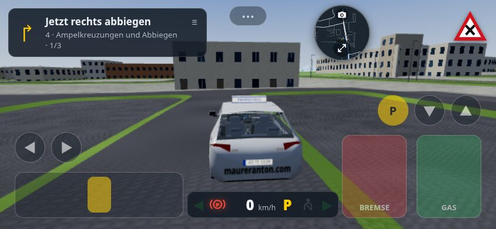
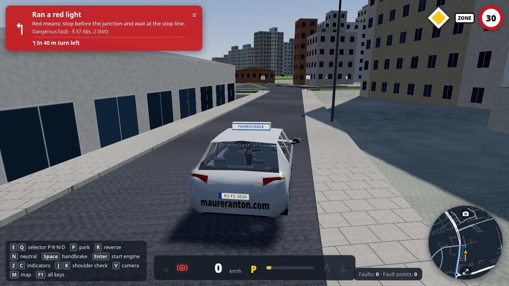
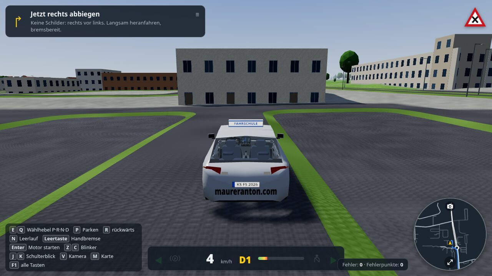
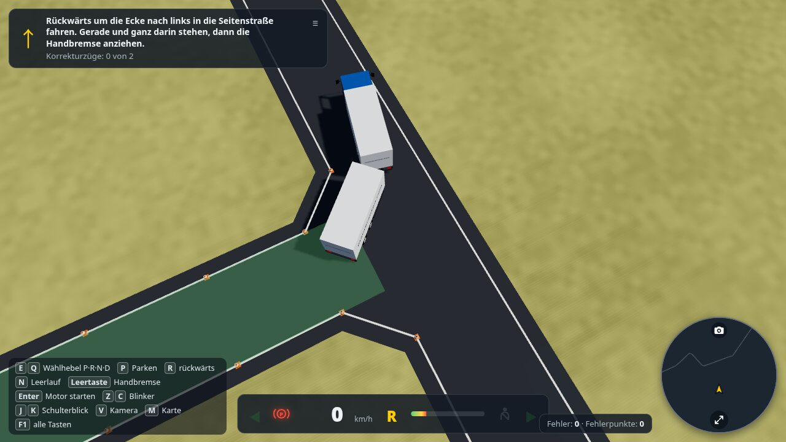
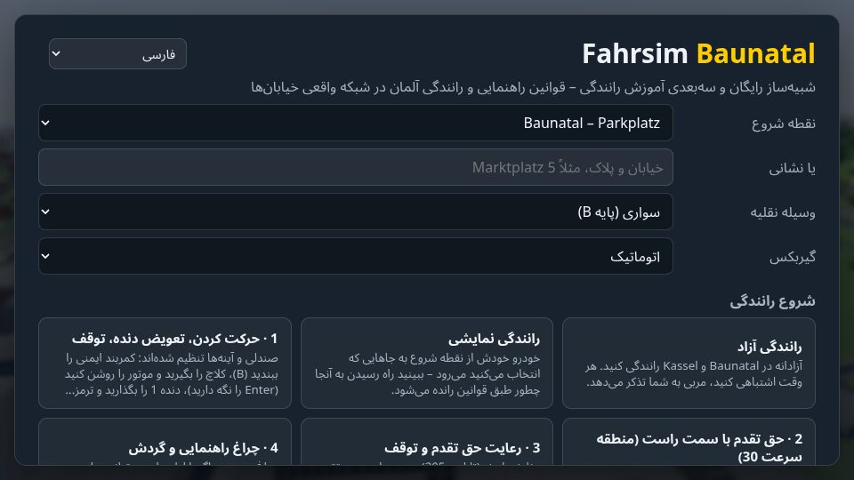
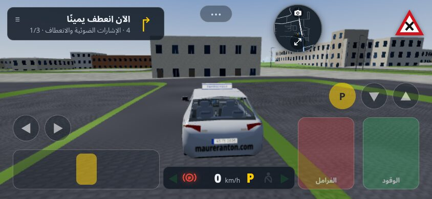

# Fahrsim Baunatal

**Freier 3D-Fahrschulsimulator für Baunatal und Kassel – deutsche Verkehrsregeln im echten Straßennetz üben,
im Pkw oder im Lkw mit Anhänger.**
Läuft im Browser, ohne Installation, ohne Konto, ohne Tracking. Freie Software unter **AGPL-3.0-only**.

▶ **Spielen:** <https://maureranton.github.io/driving-simulator/>

*English summary [below](#english).*

| | |
| --- | --- |
|  |  |
|  |  |

> Der Simulator ersetzt keine Fahrstunde und keine amtliche Prüfung. Er hilft, Regeln und Abläufe zu
> verstehen und zu üben – Verkehrsbeobachtung und Verantwortung lernt man nur im echten Verkehr mit
> einer Fahrlehrerin oder einem Fahrlehrer.

## Was drin ist

- **Baunatal und Kassel in echt:** 18 km × 18 km mit allen Straßen (rund 2 200 km) – Baunatal mit seinen
  Stadtteilen, ganz Kassel und Teile der Nachbarorte, die A 7, A 44 und A 49, Kreisverkehre, das VW-Werk –
  aus OpenStreetMap. Gelände aus dem amtlichen 1-m-Höhenmodell, rund 150 000 Gebäude mit ihren echten Höhen
  und Dachformen aus dem amtlichen 3D-Gebäudemodell (LoD2) des Landes Hessen.
- **Verkehrsregelung am richtigen Ort:** Ampeln, Zebrastreifen, Stopp- und Vorfahrt-gewähren-Schilder,
  Tempolimits, Tempo-30-Zonen, verkehrsberuhigte Bereiche, Einbahnstraßen, Abbiegeverbote und Ortstafeln aus
  den OSM-Daten. Wo OSM nichts sagt, gilt die deutsche Regel – und so stehen dort auch die Schilder
  (siehe [Kartendaten](docs/MAP_DATA.md)).
- **Fahrphysik:** Sechs-Freiheitsgrade-Fahrzeug mit Federung, Reifenmodell (Haft- und Gleitreibung,
  Lastverlagerung), Motor mit Drehmomentkurve, **Kupplung mit Schleifpunkt, Abwürgen und Anlasser**,
  6-Gang-H-Schaltung, ABS, Handbremse, Berganfahren. Automatik (Voreinstellung), Kupplungshilfe oder
  Schaltgetriebe; **Motorleistung wählbar** (60 bis 200 PS, voreingestellt 75 PS). Ein Tempobegrenzer nimmt
  bei Tastatur und Touch das Gas am Tempolimit zurück, und die Tastaturlenkung richtet sich nach der
  Querbeschleunigung – auch bei Autobahntempo bleibt das Auto ruhig.
- **Lkw mit Anhänger (Klasse CE):** ein 12-Tonner mit Tandemanhänger (15,7 m, 15,5 t) und alles, was die
  praktische Prüfung verlangt – siehe [unten](#lkw-mit-anhänger-klasse-ce).
- **Zwei Ansichten:** von außen hinter dem Fahrzeug (Voreinstellung; die Kamera lässt sich mit der Maus rund
  um das Fahrzeug drehen und im Abstand verstellen, `U` blickt nach hinten) oder aus dem **Cockpit** mit
  Lenkrad, Schalthebel, Pedalen, Kombiinstrument und **drei funktionierenden Spiegeln**, die optisch korrekt
  aus der Augposition berechnet werden. Der Innenraum lässt sich in den Einstellungen durchscheinend machen.
- **Fahrlehrer im Beifahrersitz:** Der Regelwächter erkennt u. a. zu schnelles Fahren, Rotlicht,
  überfahrene Stoppschilder, missachtete Vorfahrt (Schilder, **rechts vor links**, Kreisverkehr, § 10),
  Fehler beim Abbiegen und Blinken, Zebrastreifen, falsche Fahrtrichtung, Fahren auf dem Gehweg,
  zu geringen Abstand – jeweils mit Erklärung und Fundstelle in der StVO.
- **Fehlerprotokoll:** Jeder Fehler dieser und früherer Fahrten mit Datum, Straße und Erklärung; die
  Fundstelle führt mit einem Klick zum amtlichen Wortlaut des Paragrafen (gesetze-im-internet.de).
- **Fahrstunden und Prüfungsfahrt:** Grundlagen (Anfahren, Schalten, Anhalten), rechts vor links,
  Vorfahrtschilder, Ampeln, Kreisverkehr, Überland, Autobahn – und eine Prüfungsfahrt mit Auswertung.
- **Vorführfahrt:** Ziele auf der Karte antippen oder als Adresse eingeben – das Auto fährt selbst und
  regelgerecht dorthin. So sieht man, wie der Weg zu fahren ist: wo geblinkt und über die Schulter gesehen
  wird, wo rechts vor links gilt, wie schnell und mit welchem Abstand. Eine Zeile erklärt mit, was der
  Fahrer gerade tut; wer lenkt oder bremst, übernimmt selbst. Mehr dazu [unten](#vorführfahrt).
- **Verkehr:** Fahrzeuge, die Ampeln, Vorfahrt und Abstand beachten, Fußgänger an Überwegen – und
  **Straßenbahnen und Züge**, die auf den echten Gleisen fahren, sobald welche in der Nähe sind, und an den
  Haltestellen halten.
- **Große Karte** (`M` oder die Pfeile an der kleinen Karte): eigener Standort, die schon gefahrene Strecke,
  Ortsnamen – und in der freien Fahrt lässt sich das Fahrzeug per Fingertipp an jede Stelle setzen. Auf
  Wunsch mit den **amtlichen Luftbildern** des Landes Hessen als Hintergrund.
- **Realansicht:** „Wie sieht es hier in echt aus?“ – Taste `F` zeigt echte Straßenfotos der Stelle, an der
  das Auto steht: aus den freien Bilddiensten Panoramax, KartaView und Mapillary oder aus eigenen Bildern
  (auch 360°-Panoramen, wie sie Street-View-Downloader speichern), dazu die Koordinaten und Links, die
  dieselbe Stelle bei KartaView, Mapillary, Panoramax, Google Street View, Google Maps, Google Earth und
  OpenStreetMap öffnen. Mehr dazu [unten](#realansicht).
- **Start an jeder Adresse:** Straße und Hausnummer eintippen (rund 50 000 Hausnummern in 2 800 Straßen aus
  OpenStreetMap) – das Auto steht am Straßenrand vor dem Haus. In der freien Fahrt auch als Sprung aus dem
  Pausenmenü.
- Tastatur, Gamepad, **Lenkrad mit Pedalen und H-Schaltung** (Gamepad-API) und **Touchscreen** – auf dem
  Smartphone ist alles ohne Tastatur erreichbar. **Einstellungen**, Startpunkt, Fehlerprotokoll und
  gefahrene Strecke bleiben im Browser gespeichert.
- **28 Sprachen**, vollständig übersetzt – darunter alle Sprachen, in denen man in Deutschland die
  Theorieprüfung ablegen kann. Siehe [Sprachen](#sprachen).

| | |
| --- | --- |
|  |  |

## Steuerung (Tastatur)

| Taste | Funktion |
| --- | --- |
| `W` `S` / `↑` `↓` | Gas / Bremse |
| `A` `D` / `←` `→` | Lenken |
| `Umschalt` | Kupplung (im Modus „Kupplung selbst“) |
| `E` `Q` | Gang hoch / runter (Automatik: Wählhebel) |
| `1`–`6`, `R`, `N` | Gang direkt, Rückwärtsgang, Leerlauf |
| `Leertaste` | Handbremse |
| `Enter` (halten) / `I` | Motor starten / Zündung aus |
| `Y` `C` / `X` | Blinker links / rechts, Warnblinker (unterste Tastenreihe) |
| `J` `K` | Schulterblick links / rechts |
| `U` (halten) | nach hinten sehen |
| Maus ziehen · Mausrad | umsehen bzw. Kamera um das Fahrzeug drehen · Abstand der Kamera |
| `B` · `L` `O` · `H` | Gurt · Abblend-/Fernlicht · Hupe |
| `V` · `T` · `Esc` | Kamera (außen / Cockpit) · Fahrzeug zurück auf die Straße · Pause |
| `M` | große Karte |
| `F` | Realansicht: echte Fotos dieser Stelle |

Beim Fahren mit der Tastatur blendet der Simulator im Stand eine kurze Tastenhilfe ein (Gänge, Handbremse,
Blinker …); sie verschwindet, sobald das Auto rollt, und lässt sich in den Einstellungen abschalten.

### Maus und Touchscreen

| Antippen / Anklicken | Funktion |
| --- | --- |
| Straßenname oben links | Pausenmenü mit Einstellungen, Steuerung, Sprung zu einer Adresse |
| Karte | Realansicht: echte Fotos dieser Stelle |
| Pfeile an der Karte | große Karte: Standort, gefahrene Strecke, Fahrzeug versetzen, Luftbilder |
| Über das Bild wischen | umsehen (Schulterblick); loslassen = wieder geradeaus |
| Gelber Hinweis unten | führt den Hinweis aus (anschnallen, Motor starten, Handbremse lösen …) |

Auf dem Touchscreen liegen links die Lenkleiste und die Blinker, rechts Gas, Bremse, Gänge (▲ ▼) und
Handbremse (P); „⋯“ oben öffnet Gurt, Anlasser, Licht, Warnblinker, Hupe, Kamera und mehr. Die Mitte des
Bildes bleibt frei. Die Bedienelemente erscheinen automatisch, sobald der Bildschirm berührt wird, und
verschwinden, sobald eine Tastatur benutzt wird (praktisch bei Tablets mit Tastatur); in den Einstellungen
lassen sie sich dauerhaft ein- oder ausschalten und in der **Deckkraft** verstellen.

**Hinweise des Fahrlehrers** (Fehler rot, kleinere Fehler und Hinweise gelb) erscheinen in dem Feld, in dem
sonst der Straßenname steht. Treffen mehrere zusammen, wird der schwerwiegendste angezeigt; eine
angekündigte Abbiegung bleibt darunter lesbar.

| | |
| --- | --- |
|  |  |

## Vorführfahrt

Wer wissen will, wie eine bestimmte Strecke zu fahren ist – der Weg zur Arbeit, zur Fahrschule, die
Prüfungsstrecke –, lässt sie sich vorfahren:

1. Im Hauptmenü „Vorführfahrt“ wählen (Startpunkt oder Startadresse wie gewohnt) oder in der freien Fahrt
   die große Karte öffnen (`M`) und dort „Vorführfahrt“.
2. Ziele hinzufügen: eine Straße auf der Karte antippen und „Auto selbst dorthin fahren lassen“ – oder
   eine Adresse eingeben. Mehrere Ziele werden in ihrer Reihenfolge angefahren.
3. „Fahrt starten“: Das Auto fährt selbst los. Oben steht die Ansage des Navis, darunter, was der Fahrer
   gerade tut und warum („Vor dem Abbiegen: Spiegel, Blinker, Schulterblick – und langsamer werden“).
   Im Cockpit dreht sich dabei der Kopf zum Schulterblick. Am letzten Ziel hält das Auto an.

| | |
| --- | --- |
|  |  |

Lenken, Gas oder Bremse übergeben das Auto jederzeit an den Fahrschüler. Gefahren wird mit Automatik; es
fährt derselbe „virtuelle Fahrschüler“, der in den automatischen Tests alle Fahrstunden ohne Fehlermeldung
des Regelwächters abfährt (siehe [Tests](#tests)) – mit dem Lkw samt Anhänger ebenso.

## Lkw mit Anhänger (Klasse CE)

Im Hauptmenü lässt sich statt des Pkw ein **Lkw mit Anhänger** wählen: ein zweiachsiger 12-Tonner mit
Tandem-Zentralachsanhänger – zusammen 15,7 m lang und 15,5 t schwer, wie ihn die Fahrerlaubnis-Verordnung
für die Prüfung der Klasse CE verlangt. Der Lkw hat eine eigene Fahrphysik (Heckantrieb, automatisiertes
8-Gang-Getriebe, lange Bremswege, bei 89 km/h abgeregelt); der Anhänger
läuft der Kupplung nach, schiebt und bremst mit seiner Masse und knickt beim Rückwärtsfahren ein, wenn man
nicht rechtzeitig gegenlenkt.

Geübt wird, was die praktische Prüfung nach Anlage 7 der Fahrerlaubnis-Verordnung verlangt:

| Fahrstunde | Inhalt |
| --- | --- |
| **CE 1 · Verbinden und Trennen** | Abkuppeln und wieder ankuppeln in der richtigen Reihenfolge: Anhänger sichern (Feststellbremse, Unterlegkeile, Stützfuß), Leitungen lösen – Rot zuerst –, Kupplung öffnen, vorziehen; dann in zwei Zügen ankuppeln, Kupplung prüfen, Leitungen anschließen – Gelb zuerst –, Beleuchtung prüfen, Bremsprobe. Was zu Fuß zu tun ist, wählt man aus einer Liste; eine falsche Reihenfolge ist ein Fehler mit Erklärung. |
| **CE 2 · Rückwärts um die Ecke nach links** | Grundfahraufgabe: den Zug rückwärts in eine Seitenstraße fahren, höchstens zwei Korrekturzüge, keine Begrenzung überfahren. |
| **CE 3 · Rückwärts versetzt nach rechts an die Rampe** | Grundfahraufgabe: rückwärts in die Ladebucht, höchstens einen Meter vor der Rampe halten, ohne sie zu berühren. |
| **Prüfungsfahrt Klasse CE** | alle drei Aufgaben nacheinander, dann eine Fahrt im Verkehr. Eine misslungene Grundfahraufgabe darf einmal wiederholt werden. |

| | |
| --- | --- |
|  |  |
|  |  |

Die Bewertung der Grundfahraufgaben (Begrenzungen gelten für die Räder, zwei Korrekturzüge, eine
Wiederholung) lehnt sich an die Prüfungsrichtlinie an. Dazu kommen die Fahrstunden im Straßenverkehr und
die freie Fahrt mit dem Lkw. Der Regelwächter kennt die
Regeln für Lkw: 60 km/h außerorts und 80 km/h auf der Autobahn (§ 3 Abs. 3, § 18 Abs. 5 StVO),
Schrittgeschwindigkeit beim Rechtsabbiegen innerorts (§ 9 Abs. 6 StVO). Die Grundfahraufgaben finden auf
einem Übungsplatz statt, den das Spiel auf einem freien Feld bei Baunatal auslegt. Die Abfahrtkontrolle
gehört nicht zur Klasse CE und ist nicht nachgebildet.

## Sprachen

Deutsch · English · Bahasa Indonesia · Čeština · Español · Français · Hrvatski · Italiano · Magyar ·
Nederlands · Polski · Português · Română · Shqip · Tiếng Việt · Türkçe · Ελληνικά · Български · Русский ·
Українська · العربية · فارسی · اردو · हिन्दी · বাংলা · 简体中文 · 日本語 · 한국어

Die Sprache richtet sich beim ersten Start nach dem Browser (wer Serbisch, Bosnisch, Slowakisch oder
Malaiisch eingestellt hat, bekommt die nächstverwandte Sprache) und lässt sich oben im Hauptmenü und in den
Einstellungen umstellen; `?lang=fr` in der Adresse wählt sie für einen Besuch. Übersetzt ist alles: Menüs,
Fahrstunden, die Hinweise des Fahrlehrers mit ihren Erklärungen, die Steuerungsübersicht und die
Realansicht; Strecken, Zeiten und Datumsangaben schreibt der Browser in der Form der jeweiligen Sprache.
Die Fundstellen bleiben in jeder Sprache die deutschen (z. B. „§ 37 Abs. 2 StVO“), ebenso die Nummern der
Verkehrszeichen und natürlich die Straßennamen. Arabisch, Persisch und Urdu werden von rechts nach links
gesetzt; die Bedienelemente behalten dabei ihren Platz. Tasten werden so benannt, wie sie auf der eigenen
Tastatur stehen – gesteuert wird nach der Lage der Taste, auf einer französischen Tastatur also mit Z Q S D
statt W A S D.

| | |
| --- | --- |
|  |  |

Die Übersetzungen wurden maschinell (mit einem KI-Sprachmodell) nach einem Glossar der Fachbegriffe erstellt
und automatisch auf Vollständigkeit, Platzhalter und Länge geprüft, aber **nicht von Muttersprachlern
gegengelesen**. Verbesserungen sind willkommen: eine Sprache ist eine Datei in `src/i18n/`, die Regeln
stehen in [docs/TRANSLATING.md](docs/TRANSLATING.md), `npm run i18n:check` prüft sie.

## Realansicht

Mit `F` (oder im Pausenmenü) öffnet sich die Realansicht für die Stelle, an der das Auto gerade steht – zum
Vergleichen: Welche Schilder stehen dort wirklich, wie sieht die Kreuzung aus?


- **Freie Bilddienste:** [Panoramax](https://panoramax.fr) und [KartaView](https://kartaview.org) ohne
  Anmeldung, [Mapillary](https://www.mapillary.com) (Meta) mit einem kostenlosen Zugangsschlüssel, den man
  im Fenster einträgt. Die Fotos stehen unter CC BY-SA 4.0 und werden mit Urheber, Datum und Link zum
  Original angezeigt. Panoramax und KartaView haben Bilder aus Baunatal, wenn auch lückenhaft; Mapillary
  ist in deutschen Städten meist am dichtesten abgedeckt.
- **Eigene Bilder:** Fotos und 360°-Panoramen vom eigenen Gerät (JPEG, PNG, WebP) per Dateiauswahl, Ordner
  oder Ziehen ins Fenster – etwa mit *streetview-dl*, *streetviewdownloader* oder einer Browser-Erweiterung
  gespeicherte Panoramen. Position und Blickrichtung werden aus EXIF/XMP, einer beiliegenden Liste (JSON,
  GeoJSON, CSV) oder dem Dateinamen gelesen; Panoramen lassen sich mit der Maus drehen und zeigen zuerst in
  Fahrtrichtung. Die Bilder bleiben auf dem eigenen Gerät. Einzelheiten:
  [public/panos/README.md](public/panos/README.md).
- **Dieser Ort:** Oben im Fenster stehen die Koordinaten (zum Kopieren) und Links, die dieselbe Stelle in
  einem neuen Tab öffnen: KartaView, Mapillary, Panoramax, Google Street View, Google Maps (Satellit),
  Google Earth und OpenStreetMap.
- **Luftbild:** „Luftbild auf der Karte“ öffnet die große Karte an dieser Stelle mit den amtlichen
  Luftbildern des Landes Hessen (DOP20, 20 cm je Bildpunkt) – offene Daten, die direkt vom Geodatendienst
  des Landes geladen werden.

**Datenschutz:** Der Simulator selbst ruft nichts ab. Erst wenn man in der Realansicht einen Dienst anhakt
oder auf der Karte die Luftbilder einschaltet, fragt der Browser diesen Dienst direkt – er erfährt dabei
die IP-Adresse und die Stelle auf der Karte.
**Lizenz:** Es werden keine fremden Bilder mit dem Projekt ausgeliefert; Bilder von Google Street View und
anderen nicht frei lizenzierten Quellen kann man für sich selbst laden, aber nicht weitergeben.

Wer eine eigene Kopie betreibt, kann einen Mapillary-Schlüssel als Repository-Variable `MAPILLARY_TOKEN`
hinterlegen (er wird beim Bauen als `VITE_MAPILLARY_TOKEN` eingesetzt) und eigene, frei lizenzierte Bilder
über `public/panos/` und `npm run panos:index` für alle Besucher bereitstellen.

## Lokal starten

Voraussetzung: [Node.js](https://nodejs.org) ≥ 24.

```bash
git clone https://github.com/MaurerAnton/driving-simulator.git
cd driving-simulator
npm install
npm run dev        # http://127.0.0.1:5173
npm run build      # statische Seite in dist/
```

Die fertige Karte liegt im Repository (`public/map`), zum Spielen und Entwickeln müssen keine Geodaten
geladen werden.

### Tests

```bash
npm test             # 92 Tests: Fahrdynamik von Pkw (21) und Lkw mit Anhänger (6), Realansicht (15),
                     # Adresssuche, Hinweise, Fehlerprotokoll, Karte (15), Straßenbahnen (9), Klasse CE (16), Sprachen (10)
npm run i18n:check   # Übersetzungen prüfen (Vollständigkeit, Platzhalter, Längen)
npm run test:traffic # Verkehrssimulation im Dauerlauf auf der echten Karte
npm run test:drive   # „virtueller Fahrschüler“ – der Fahrer der Vorführfahrten – fährt alle Fahrstunden regelkonform ab
npm run test:drive:truck     # … mit Lkw und Anhänger, einschließlich der Prüfungsfahrt der Klasse CE
npm run test:drive:traffic   # … im Umgebungsverkehr: Abstand, Vorfahrt, Fußgänger
```

## Karte neu erzeugen

Die Karte entsteht vollständig automatisch aus offenen Daten – auch für andere hessische Gemeinden
anpassbar. Details, Download-Befehle und Lizenzen: **[docs/MAP_DATA.md](docs/MAP_DATA.md)**.

```bash
npm run map:all    # OSM-Auszug schneiden → LoD2 einlesen → Karte bauen → Adressliste (ca. 25 Minuten)
```

**Ein Schild fehlt oder steht falsch?** Die Verkehrsregelung kommt aus OpenStreetMap. Am nachhaltigsten ist
es, den Fehler dort zu beheben (z. B. `highway=give_way` mit `direction`, `maxspeed`, `traffic_sign`) –
davon profitieren alle Karten und Navis. Nach dem nächsten Kartenlauf ist er auch hier korrigiert.

## Aufbau

```
src/geo, src/core      Projektion (ETRS89/UTM32), Geometrie
src/world              Straßennetz-Modell: Knoten, Kanten, Kreuzungsgeometrie, Fahrstreifen, Vorfahrt
src/sim/vehicle        Fahrdynamik von Pkw und Lkw (ohne Abhängigkeiten, deterministisch)
src/sim                Verkehr, Ampeln, Regelwächter, Kollisionen, Anhänger, Straßenbahnen und Züge,
                       der regeltreue Fahrer der Vorführfahrten (autodriver.ts)
src/render             three.js: Kacheln, Gebäude, Schilder, Fahrzeuge, Cockpit, Spiegel, Übungsplatz
src/i18n               Texte: eine Datei je Sprache, Tastenbeschriftung nach Tastaturbelegung
src/reality            Realansicht: Bild-Metadaten (EXIF/XMP), eigene Bilder, freie Bilddienste, Luftbilder
src/game, src/ui       Spielablauf, Fahrstunden, Aufgaben der Klasse CE, Navigation, HUD, Menüs, große Karte
tools/                 Kartenpipeline (OSM-PBF-Leser, Höhenmodell, LoD2, Straßennetz, 3D-Netze, Kacheln),
                       Verzeichnis eigener Straßenbilder (tools/panos)
tests/                 Fahrdynamik-Tests, Verkehrs-Dauerlauf, virtueller Fahrschüler
```

Dieselbe Geometrie- und Vorfahrtlogik läuft in der Kartenpipeline, in der Physik, im Verkehr und im
Regelwächter – was man sieht, worauf die Reifen stehen und wonach bewertet wird, ist deshalb identisch.

## Stand und bekannte Grenzen

- **Automatisch geprüft:** 92 Tests (Fahrdynamik von Pkw und Lkw, Anhänger, Aufgaben der Klasse CE,
  Straßenbahnen, Sprachen …), ein Dauerlauf des Umgebungsverkehrs und ein „virtueller Fahrschüler“, der
  alle Fahrstunden und die Prüfungsfahrt (zusammen rund 56 km) regelkonform abfährt, ohne dass der
  Regelwächter einen Fehler meldet – ebenso mit Lkw und Anhänger die Prüfungsfahrt der Klasse CE.
  Derselbe Fahrer fährt die Vorführfahrten.
- **Vorführfahrt im Verkehr:** Der Fahrer hält Abstand, gewährt Vorfahrt, lässt Fußgänger gehen, wechselt
  den Fahrstreifen nur in eine Lücke und sieht an großen Knotenpunkten selbst nach dem Querverkehr. Im
  Testlauf mit Umgebungsverkehr (alle Fahrstunden, 56 km) blieb er ohne Unfall; unfehlbar ist er im dichten
  Verkehr nicht – vereinzelt muss ein anderes Fahrzeug seinetwegen bremsen, oder er wartet lange. Ohne
  Umgebungsverkehr (Verkehrsdichte 0 in den Einstellungen) fährt er die geprüften Strecken ohne
  Beanstandung.
- **Ergänzte Regelung:** Was in OpenStreetMap nicht erfasst ist (etwa ein fehlendes Vorfahrtschild), wird
  nach den Grundregeln der StVO ergänzt und kann von der Wirklichkeit abweichen. Ampeln laufen mit
  plausiblen Festzeiten, nicht mit der echten Schaltung.
- **Umgebungsverkehr:** beachtet Vorfahrt, Ampeln und Abstand, ist an großen Knotenpunkten aber nicht
  fehlerfrei – vereinzelt blockieren sich Fahrzeuge oder kommen sich zu nahe. Fußgänger gibt es nur an
  Überwegen, Radfahrer noch nicht.
- **Darstellung:** Gebäude haben echte Form und Höhe, aber keine Fototexturen; Fahrzeuge und Cockpit sind
  vollständig prozedural erzeugt.
- **Lkw:** Der Anhänger folgt der Kupplung als geführtes Modell – er wirkt mit seiner Masse auf den Lkw,
  stößt aber selbst nicht an Gebäude oder Schilder und kippt nicht. Das Verbinden und Trennen prüft die
  Reihenfolge der Handgriffe, nicht die Handgriffe selbst. Sattelzüge gibt es nicht.
- **Straßenbahnen und Züge:** fahren ohne Fahrplan und Linien und beachten einander und Fahrzeuge auf dem
  Gleis, aber keine Signale; Schranken an Bahnübergängen gibt es nicht.
- **Größe der Karte:** Das Straßennetz beider Städte wird beim Start vollständig geladen (6 MB); auf
  langsamen Geräten dauert das einige Sekunden länger als früher mit Baunatal allein.
- **Andere Länder:** Regeln, Schilder und Datenquellen sind die deutschen bzw. hessischen. Für andere
  hessische Gemeinden genügt ein neuer Kartenlauf; andere Bundesländer brauchen angepasste Leser für
  Höhenmodell und Gebäude, andere Staaten zusätzlich ein eigenes Regelwerk – das gibt es noch nicht.

## Lizenz

- **Programm:** GNU Affero General Public License, Version 3 – ausschließlich diese Version
  (`AGPL-3.0-only`), siehe [LICENSE](LICENSE). Wer eine veränderte Fassung im Netz betreibt, muss deren
  Quelltext anbieten.
- **Kartendaten** (`public/map`): abgeleitete Datenbank aus © OpenStreetMap-Mitwirkende,
  [ODbL 1.0](https://opendatacommons.org/licenses/odbl/1-0/); Gelände und Gebäude aus offenen Geobasisdaten
  der Hessischen Verwaltung für Bodenmanagement und Geoinformation.
- **Verkehrszeichen** (`public/signs`): amtliche Werke, gemeinfrei (§ 5 Abs. 1 UrhG), Grafiken von
  Wikimedia Commons.
- **Straßenfotos der Realansicht:** nicht Teil des Projekts – sie werden auf Wunsch live von Panoramax,
  KartaView oder Mapillary geladen (CC BY-SA 4.0, Urheber wird angezeigt) oder stammen vom eigenen Gerät.
- **Abhängigkeiten:** three.js (MIT). Es werden keine Schriften, Texturen, Modelle oder Tondateien
  mitgeliefert – alles wird zur Laufzeit erzeugt.

Einzelheiten: [NOTICE.md](NOTICE.md).

---

<a id="english"></a>

## English

**Fahrsim Baunatal** is a free (AGPL-3.0-only) browser-based 3D driving-school simulator set in the real
German towns of Baunatal and Kassel. It is meant to help learner drivers understand and practise German
traffic rules (StVO) – in a car or in a truck with a trailer.

- The real road network of an area of 18 km × 18 km (about 2,200 km of roads, the A 7, A 44 and A 49
  motorways) with its traffic lights, signs, speed limits, zones, one-way streets and roundabouts from
  OpenStreetMap; terrain from the official 1 m elevation model and about 150,000 buildings with real
  heights and roof shapes from the State of Hesse's open LoD2 model.
- A physically based car: 6-DOF body, suspension, tyre model, engine, **clutch with biting point and
  stalling**, 6-speed H-gate gearbox, ABS, hill starts. Automatic by default, clutch assist or manual
  optional; engine power can be chosen (60 to 200 PS, 75 by default); a speed limiter eases the throttle
  off at the limit for keyboard and touch, and keyboard steering is limited by lateral acceleration, so
  the car stays calm at motorway speeds.
- **A truck with a trailer (licence class CE):** a two-axle 12-tonne truck with a tandem centre-axle
  trailer (15.7 m, 15.5 t) and what the German practical test asks for – uncoupling and coupling in the
  right order, reversing round a corner to the left, reversing to a loading ramp with an offset to the
  right, and a test drive; the rule monitor knows the truck rules (60 km/h outside built-up areas, 80 km/h
  on motorways, right turns in town at walking pace).
- Two views: from outside behind the vehicle (the default; drag the mouse to circle the camera, wheel to
  zoom, `U` to look back) or from the cockpit with steering wheel, shifter, pedals, instruments and **three
  working mirrors**; the interior can be made see-through in the settings.
- A rule monitor that explains every mistake with its legal basis: speeding, red lights, stop signs, right
  of way (signs, *right before left*, roundabouts), indicating, pedestrian crossings, wrong-way driving …
  – and a **mistake log** that keeps the faults of all drives and links each one to the official text of
  the paragraph.
- Lessons, a simulated driving test, ambient traffic and pedestrians – and **trams and trains** that run on
  the real tracks whenever some are near, and stop at the stops.
- **Demonstration drives:** choose destinations on the map or by address and the car drives there by
  itself, by the rules – to watch how the way is driven (where to indicate and look over the shoulder,
  where right before left applies, at what speed and distance), with a line saying what the driver is
  doing just now. Steering or braking hands the car back at any time.
- A **full-screen map** (`M`): where you are, the path already driven, and in free drive a tap puts the
  vehicle anywhere; optionally over the State of Hesse's official aerial photographs.
- Keyboard / gamepad / wheel / touch. On a phone everything works without a keyboard: tap the street name
  for the menu, the map for real photos, swipe to look around; the on-screen controls leave the middle of
  the picture free and their opacity can be set. With a keyboard they hide and a short key reminder is
  shown instead. Settings, start point, mistake log and driven path are kept in the browser.
- Start at any address: type a street and house number (about 50,000 house numbers from OpenStreetMap).
- The instructor's notices (red for serious faults, yellow for minor ones) appear in the street-name block;
  if several coincide, the gravest is shown.
- **28 languages**, fully translated (all the languages of the German theory test among them, and
  right-to-left layout for Arabic, Persian and Urdu); the translations are machine-made from a glossary and
  checked automatically, not proof-read by native speakers – see
  [docs/TRANSLATING.md](docs/TRANSLATING.md) to improve one or add another.
- A **reality view** (key `F`): real street-level photographs of the place the car is at – from the free
  imagery services Panoramax, KartaView and Mapillary (CC BY-SA 4.0, only requested when you switch a
  service on) or from your own files, including 360° panoramas saved with street-view download tools
  (they stay on your device); plus the coordinates and links that open the place at KartaView, Mapillary,
  Panoramax, Google Street View, Google Maps, Google Earth and OpenStreetMap.

Verified automatically by 92 unit tests (vehicle dynamics of car and truck, the trailer, the class-CE
tasks, trams, languages …), a traffic soak run and a "virtual learner driver" – the driver of the
demonstration drives – that completes every lesson and the driving test (about 56 km in total) without a
single fault being reported, and with truck and trailer the class-CE test drive as well. Known limits: rules
missing in OpenStreetMap are filled in from the general StVO rules and may differ from reality; traffic-light
timings are plausible fixed cycles; the ambient traffic is not perfect at large junctions, and neither is the
demonstration driver among it; the trailer follows the coupling without colliding with scenery; trams keep
no timetable and obey no signals; there are no cyclists yet; and only German rules and Hessian data are
supported – other countries would need their own data readers and rule sets.

Play at <https://maureranton.github.io/driving-simulator/>, or run locally with `npm install && npm run dev`
(Node.js ≥ 24). The map is generated by the pipeline in `tools/` from open data only; see
[docs/MAP_DATA.md](docs/MAP_DATA.md). The simulator is no substitute for lessons with an instructor.
